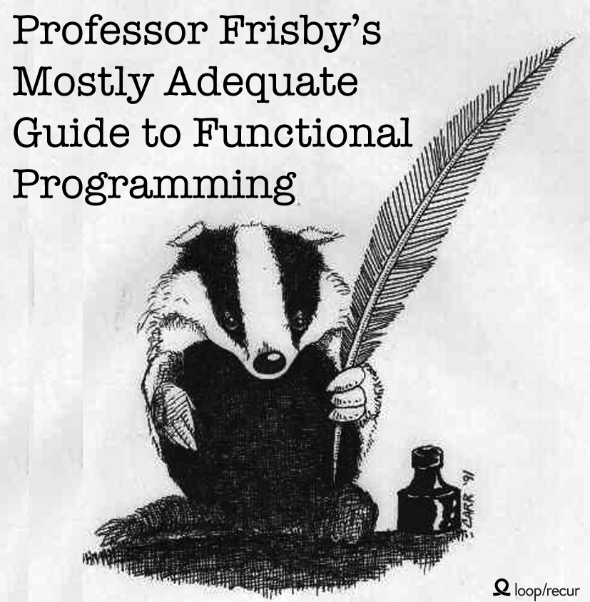

[](SUMMARY.md)

## 关于这本书

这是一本大体上讲函数式范式的书。我们会用世界上最流行的函数式编程（functional programming）语言：JavaScript。有人可能觉得这选择不怎么样，因为它跟当下的潮流有点拧着来——眼下的风气，怎么说呢，主要是命令式的。不过我相信，用 JavaScript 学 FP 是最好的办法，理由有好几个：

 * **你很可能每天都在工作里用它。**

    这让你每天都能在真实世界的程序里练习、应用学到的东西，而不是等到晚上和周末，在一个冷门的 FP 语言里搞点宠物项目。


 * **我们不必先把一切学全，才能开始写程序。**

    在纯函数式语言里，不借助单子（monad），你连打印个变量或者读个 DOM 节点都做不到。在这里，我们可以在学着净化代码库的同时稍微作弊一下。而且这门语言是混合范式的，上手更容易：知识有缺口的时候，你还能退回到自己现在的做法。


 * **这门语言完全有能力写出顶尖的函数式代码。**

    借助一两个小库，我们需要的特性都有，足以模仿 Scala 或 Haskell 那样的语言。眼下业界是面向对象编程占主导，可它在 JavaScript 里显然别扭得很。就像在高速公路旁边露营，或者穿着橡胶套鞋跳踢踏舞。我们得到处 `bind`，免得 `this` 在脚底下被换掉；忘记 `new` 时有各种对付古怪行为的绕行方案；私有成员只能靠闭包实现。对我们很多人来说，反正 FP 感觉更自然。

话说回来，带类型的函数式语言，毫无疑问是写这本书所讲风格的最佳场所。JavaScript 只是我们学习范式的手段，至于在哪儿用，由你决定。幸运的是，这些接口是数学的，因而无处不在。你会发现自己在 Swiftz、Scalaz、Haskell、PureScript 以及其他偏数学的环境里如鱼得水。


## 在线阅读

想要最佳阅读体验，请[通过 GitBook 在线阅读](https://mostly-adequate.gitbooks.io/mostly-adequate-guide/)。

- 随手可用的侧边栏
- 浏览器内练习
- 深入的例子


## 把代码玩起来

为了让训练高效一点，别在我又讲一个故事的时候太无聊，请务必把书里介绍的概念玩一玩。有些概念一开始不太好抓，动手弄脏了才更好理解。
书里出现的所有函数和代数数据类型都收集在附录里。相应的代码也有 npm 包：

```bash
$ npm i @mostly-adequate/support
```

另外，每章的练习都能跑起来，也能在编辑器里完成！比如，先做完 `exercises/ch04` 里的 `exercise_*.js`，然后运行：

```bash
$ npm run ch04
```

## 下载

预先生成好的 **PDF** 和 **EPUB** 可以在[最新发布的构建产物](https://github.com/MostlyAdequate/mostly-adequate-guide/releases/latest)里找到。

## 自己动手

> ⚠️ 这个项目的构建配置现在有点老了，本地构建时你可能会遇到各种问题。建议尽量使用 node v10.22.1 和最新版的 Calibre。

### 关于 nodejs 版本

推荐的 node 版本（v10.22.1）现在有点旧了，你系统里很可能没装。你可以用 [nvm](https://github.com/nvm-sh/nvm) 在系统上装多个 nodejs 版本。照着那个项目的说明装好，然后就能：

 - 安装你需要的任何 node 版本：
```
nvm install 10.22.1
nvm install 20.2.0
```
 - 然后就能在版本之间切换：
```
nvm use 10.22.1
node -v // 会显示 v10.22.1
nvm use 20.2.0
node -v // 会显示 v20.2.0
```

因为项目里有 .nvmrc 文件，你不指定版本也能直接 `nvm install` 和 `nvm use`：
```
// 在项目内任意位置
nvm install
node -v // 会显示 v10.22.1
```


### 完整的命令序列

考虑到上面关于装好 nvm 的说明，下面是自己生成 pdf 和 epub 文件的完整命令序列：

```
git clone https://github.com/MostlyAdequate/mostly-adequate-guide.git
cd mostly-adequate-guide/
nvm install
npm install
npm run setup
npm run generate-pdf
npm run generate-epub
```

补充一句：本仓库的依赖已经用 pnpm 装好了，平时读代码、跑练习都不受影响；但 GitBook 3 只能在 node 10 下运行，所以真正构建电子书时请按上面的 npm 流程走，或者直接执行 `nvm exec 10.22.1 ./node_modules/.bin/gitbook build`。

> 注意！生成电子书版本需要安装 `ebook-convert`。[安装说明](https://gitbookio.gitbooks.io/documentation/content/build/ebookconvert.html)。

# 目录

见 [SUMMARY.md](SUMMARY.md)

### 参与贡献

见 [CONTRIBUTING.md](CONTRIBUTING.md)

### 译本

见 [TRANSLATIONS.md](TRANSLATIONS.md)

### 常见问题

见 [FAQ.md](FAQ.md)


# 未来的计划

* **第 1 部分**（第 1 至 7 章）是基础指南。这是初稿，我发现错误就会更新。欢迎帮忙！
* **第 2 部分**（第 8 至 13 章）讲函子（functor）和单子这类类型类（type class），一路讲到可遍历。我希望能再塞进转换器（transformer）和一个纯应用。
* **第 3 部分**（第 14 章以后）会在实用编程与学术荒诞之间走钢丝。我们会看看余单子（comonad）、F-代数、自由单子（free monad）、Yoneda 以及其他范畴论（category theory）构造。


---


<p align="center">
  <a rel="license" href="http://creativecommons.org/licenses/by-sa/4.0/">
    
  </a>
  <br />
  本作品采用<a rel="license" href="http://creativecommons.org/licenses/by-sa/4.0/">知识共享 署名-相同方式共享 4.0 国际许可协议</a>进行许可。
</p>
