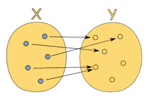
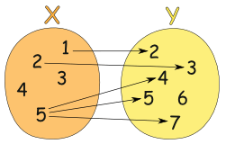
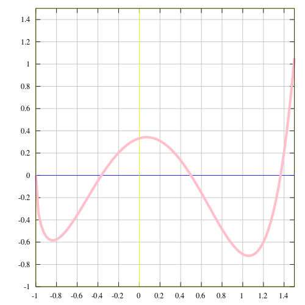

# 第 03 章：纯函数，纯粹的快乐

## 哦，让我再纯洁一回

有一件事我们得先掰扯清楚：纯函数（pure function）到底是个什么概念。

>纯函数是这样的函数：给定相同的输入，它总是返回相同的输出，并且没有任何可观察的副作用（side effect）。

拿 `slice` 和 `splice` 来说吧。这俩函数干的是完全一样的事——不过我得提醒你，方式天差地别，但说到底还是一回事。我们说 `slice` 是*纯*的，因为对同一个输入，它每次都保证返回同一个输出。可 `splice` 呢，它会把自己的数组嚼一遍再吐出来，吐出来的东西已经永远变了样——这可是看得见摸得着的效应。

```js
const xs = [1,2,3,4,5];

// 纯
xs.slice(0,3); // [1,2,3]

xs.slice(0,3); // [1,2,3]

xs.slice(0,3); // [1,2,3]


// 不纯
xs.splice(0,3); // [1,2,3]

xs.splice(0,3); // [4,5]

xs.splice(0,3); // []
```

在函数式编程（functional programming）里，我们不喜欢 `splice` 这种笨重又爱*改动*数据的函数。这绝对不行——我们追求的是每次都返回同一结果的可靠函数，而不是 `splice` 这种一路走来留下一地鸡毛的函数。

再看一个例子。

```js
// 不纯
let minimum = 21;
const checkAge = age => age >= minimum;

// 纯
const checkAge = (age) => {
  const minimum = 21;
  return age >= minimum;
};
```

在那个不纯的版本里，`checkAge` 依赖可变变量 `minimum` 来决定结果。换句话说，它依赖系统状态——这挺让人失望的，因为它引入了一个外部环境，从而增加了[认知负荷](https://en.wikipedia.org/wiki/Cognitive_load)。

这个例子里看着也许不算什么，但这种对状态的依赖是系统复杂性的最大来源之一（http://curtclifton.net/papers/MoseleyMarks06a.pdf）。这个 `checkAge` 可能因为输入之外的因素返回不同结果，这不仅让它没资格当纯函数，还让我们每次推理这段软件时都得把脑子过一遍绞肉机。

而它的纯版本则完全自给自足。我们还可以把 `minimum` 变成不可变的，这样状态永不改变，纯粹性也就守住了。要做到这一点，我们得先创建一个对象，好把它冻起来。

```js
const immutableState = Object.freeze({ minimum: 21 });
```

## 副作用可能包括……

咱们再仔细看看这些“副作用”，好养养直觉。那么，*纯函数*定义里提到的那个毫无疑问十恶不赦的*副作用*，到底是个什么东西？我们把*效应*这个词用来指：在一次计算中，除了算出结果之外发生的任何事情。

效应本身并没有天生的坏处，接下来的章节里我们到处都会用到它们。背黑锅的是*副*这个字——它自带负面含义。水本身并不是天生的幼虫孵化器，是*一潭死水*那一面养出了一群群的虫子；我向你保证，*副*作用在你自己的程序里，也是一模一样的繁殖温床。

>*副作用*是指在计算结果的过程中，发生的系统状态改变，或与外部世界之间的*可观察交互*。

副作用可能包括但不限于

  * 改动文件系统
  * 往数据库里插一条记录
  * 发起一次 http 调用
  * 数据变更
  * 往屏幕上打印 / 打日志
  * 获取用户输入
  * 查询 DOM
  * 访问系统状态

这清单还能一直列下去。函数之外的世界，任何与之打交道的动作都是副作用——这个事实可能会让你怀疑：不写副作用还编得动程序吗？函数式编程的哲学则断定，副作用正是错误行为的主要成因。

并不是说我们被禁止使用副作用——我们是想把它们关起来，用受控的方式去执行。等后面讲到函子（functor）和单子（monad）时，我们会学怎么做；眼下呢，咱们先试着把这些阴险的函数跟纯函数隔离开。

副作用会让一个函数失去*纯*的资格。这很合理：按定义，纯函数对同一个输入必须永远返回同一个输出，而一旦牵扯到我们局部函数之外的事情，这一点就没法保证了。

咱们再仔细瞧瞧，为什么我们非要坚持“同一个输入对应同一个输出”不可。把领子竖起来吧，接下来要看的可是八年级数学。

## 八年级数学

摘自 mathisfun.com：

> 函数是值之间的一种特殊关系：
> 每一个输入值都恰好还回一个输出值。

换句话说，它不过是两个值之间的一种关系：输入和输出。虽然每个输入都恰好有一个输出，但这个输出不必对每个输入都独一无二。下图展示了一个从 `x` 到 `y` 的完全合法的函数：

(https://www.mathsisfun.com/sets/function.html)

作为对比，下图展示了一个*不是*函数的关系，因为输入值 `5` 指向了好几个输出：

(https://www.mathsisfun.com/sets/function.html)

函数可以描述成一组位置为（输入，输出）的数对：`[(1,2), (3,6), (5,10)]`（看起来这个函数把输入翻了一倍）。

或者画成一张表：
<table> <tr> <th>输入</th> <th>输出</th> </tr> <tr> <td>1</td> <td>2</td> </tr> <tr> <td>2</td> <td>4</td> </tr> <tr> <td>3</td> <td>6</td> </tr> </table>

甚至还能画成图，`x` 是输入，`y` 是输出：




只要输入决定了输出，实现细节就无关紧要。既然函数不过是输入到输出的映射，那完全可以随手写个对象字面量，然后用 `[]` 而不是 `()` 去调用它。

```js
const toLowerCase = {
  A: 'a',
  B: 'b',
  C: 'c',
  D: 'd',
  E: 'e',
  F: 'f',
};
toLowerCase['C']; // 'c'

const isPrime = {
  1: false,
  2: true,
  3: true,
  4: false,
  5: true,
  6: false,
};
isPrime[3]; // true
```

当然，你可能更想计算而不是手写一大堆，但这说明了思考函数的另一种方式。（你也许在想：“那带多个参数的函数呢？”确实，用数学的语言来想这件事会有点不方便。眼下我们可以把它们打包成一个数组，或者干脆把 `arguments` 对象当成输入。等学到*柯里化*（currying），我们就会看到怎么直接照着函数的数学定义来建模。）

戏剧性的揭晓来了：纯函数*就是*数学意义上的函数，而函数式编程讲的正是这回事。跟这些小天使一起编程，好处大得惊人。咱们来看看，究竟是哪些理由让我们心甘情愿费这么大劲去保住纯粹性。

## 为纯粹性辩护

### 可缓存

首先，纯函数总是可以按输入缓存。通常用的技巧叫记忆化（memoization）：

```js
const squareNumber = memoize(x => x * x);

squareNumber(4); // 16

squareNumber(4); // 16，返回输入 4 的缓存

squareNumber(5); // 25

squareNumber(5); // 25，返回输入 5 的缓存
```

下面是个简化版实现，市面上当然还有一大堆更结实的版本。

```js
const memoize = (f) => {
  const cache = {};

  return (...args) => {
    const argStr = JSON.stringify(args);
    cache[argStr] = cache[argStr] || f(...args);
    return cache[argStr];
  };
};
```

值得注意的是，你可以通过延迟求值，把某些不纯的函数变成纯函数：

```js
const pureHttpCall = memoize((url, params) => () => $.getJSON(url, params));
```

有意思的是，我们并没有真的发起 http 调用——我们返回的是一个函数，等它被调用时才会去发。这个函数是纯的，因为同样的输入永远得到同样的输出：那个给定 `url` 和 `params` 就会发起特定 http 调用的函数。

我们的 `memoize` 函数干得挺好，只不过它缓存的不是 http 调用的结果，而是生成出来的那个函数。

这眼下还没什么大用，但很快我们就会学到几招，让它变得有用。要点是：不管一个函数看起来多能搞破坏，我们都能把它缓存起来。

### 可移植 / 自文档化

纯函数是完全自包含的。函数需要的一切，都用银盘子端到它面前。你琢磨一下……这有什么好处？首先，函数的依赖是显式的，所以更容易看见、更容易理解——底下不会藏着什么见不得人的勾当。

```js
// 不纯
const signUp = (attrs) => {
  const user = saveUser(attrs);
  welcomeUser(user);
};

// 纯
const signUp = (Db, Email, attrs) => () => {
  const user = saveUser(Db, attrs);
  welcomeUser(Email, user);
};
```

这个例子说明，纯函数必须对自己的依赖诚实，因此它也会一五一十地告诉我们它要干什么。光看它的类型签名（type signature），我们就知道它会用到 `Db`、`Email` 和 `attrs`——这些信息，说得最保守，也足够说明问题了。

我们以后会学到，怎么让这种函数真正变纯，而不是只靠延迟求值蒙混过关；但要点已经很清楚了：纯的版本比它那个鬼鬼祟祟、天知道在背后干什么的不纯版本，信息量大得多。

还有一点值得注意：我们被逼着去“注入”依赖，也就是把它们当参数传进来。这让我们的应用灵活多了，因为数据库、邮件客户端或者别的什么，都被我们参数化了（别担心，我们会找到办法，让它没有听起来那么累）。想换一个 Db？拿它去调用我们的函数就行。发现自己正在写一个新应用、又想复用这个可靠的函数？把这个函数需要的 `Db` 和 `Email` 给它就完事。

在 JavaScript 的世界里，可移植可能意味着把函数序列化，然后通过 socket 发出去；也可能意味着把我们所有应用代码都放进 web worker 里跑。可移植性是一种很强大的特性。

命令式编程里那些“典型”的方法和过程，深深扎根于自己的环境——靠的是状态、依赖和可用的效应；纯函数正相反，我们心里想让它在哪儿跑，它就能在哪儿跑。

你上一次把一个方法复制到新应用里，是什么时候？我最喜欢的一句名言出自 Erlang 之父 Joe Armstrong：“面向对象语言的问题在于，它们随身拖着一整套隐式环境。你想要一根香蕉，结果得到的是一只攥着香蕉的大猩猩……外加整片丛林。”

### 可测试

接下来我们会发现，纯函数让测试容易得多。我们不用伪造一个“真的”支付网关，也不用在每个测试之后搭好场景、再断言世界处于什么状态。给函数输入，断言输出，就这么简单。

事实上，函数式社区正在开创新一代测试工具：用生成的输入狂轰滥炸我们的函数，再断言输出满足某些性质。这超出了本书范围，但我强烈建议你搜一搜、试一试 *Quickcheck*——一个为纯函数式环境量身定做的测试工具。

### 讲得通

很多人认为，使用纯函数最大的收获是*引用透明*（referential transparency）。当一段代码可以被替换成它求值后的结果、而程序行为不变时，这段代码就是引用透明的。

既然纯函数没有副作用，它们就只能通过自己的输出值去影响程序的行为。再者，既然只用输入值就能可靠地算出输出值，纯函数就总能保住引用透明。看个例子。


```js
const { Map } = require('immutable');

// 简写：p = 玩家（player），a = 攻击者（attacker），t = 目标（target）
const jobe = Map({ name: 'Jobe', hp: 20, team: 'red' });
const michael = Map({ name: 'Michael', hp: 20, team: 'green' });
const decrementHP = p => p.set('hp', p.get('hp') - 1);
const isSameTeam = (p1, p2) => p1.get('team') === p2.get('team');
const punch = (a, t) => (isSameTeam(a, t) ? t : decrementHP(t));

punch(jobe, michael); // Map({name:'Michael', hp:19, team: 'green'})
```

`decrementHP`、`isSameTeam` 和 `punch` 都是纯的，所以都是引用透明的。我们可以用一种叫*等式推理*（equational reasoning）的技巧，也就是拿“等量代换等量”来推理代码。这有点像手工对代码求值，只不过不用管程序化求值那些古怪脾气。趁着引用透明，咱们把这段代码玩一玩。

首先，我们把 `isSameTeam` 这个函数内联进去。

```js
const punch = (a, t) => (a.get('team') === t.get('team') ? t : decrementHP(t));
```

既然我们的数据是不可变的，就可以干脆把队伍名替换成它们的实际值

```js
const punch = (a, t) => ('red' === 'green' ? t : decrementHP(t));
```

我们看到这种情况结果是 false，于是整个 if 分支都可以删掉

```js
const punch = (a, t) => decrementHP(t);
```

再把 `decrementHP` 内联进来，就会看到在这个情形下，punch 变成了一个把 `hp` 减 1 的调用。

```js
const punch = (a, t) => t.set('hp', t.get('hp') - 1);
```

这种推理代码的能力，对重构和一般意义上的理解代码都妙不可言。事实上，我们就是用这个技巧重构了海鸥群那个程序的——我们靠等式推理，借用了加法和乘法的性质。没错，整本书里我们都会用到这些技巧。

### 并行代码

最后，这是致命一击（coup de grâce）：任何纯函数都能并行运行，因为它不需要访问共享内存，而且按定义，它也不可能因为什么副作用而出现竞态条件。

在有线程的服务端 js 环境里，或者在浏览器里用 web worker，这都完全可行——只不过如今的风气似乎躲着它走，因为一旦跟不纯的函数搅在一起，事情就复杂了。


## 总结

我们已经看到了纯函数是什么，也看到了我们这些函数式程序员为什么觉得它们简直是猫界晚礼服。从这儿往后，我们会努力把所有函数都写成纯的。要做到这一点，我们还得配几件额外工具，但在此之前，我们先把不纯的函数从纯代码里隔出去。

腰带上没有几件额外工具，用纯函数写程序是有点费劲。我们得靠到处传参来耍数据，被禁止使用状态，更别提效应了。这种受虐倾向的程序到底该怎么写？咱们去弄一件新工具来，它叫 curry。

[第 04 章：柯里化](ch04.md)
