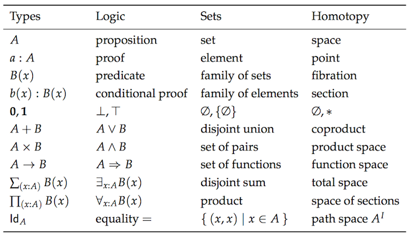
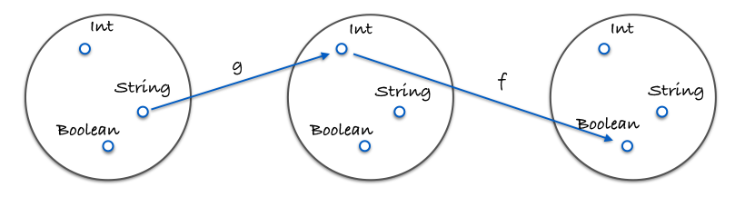
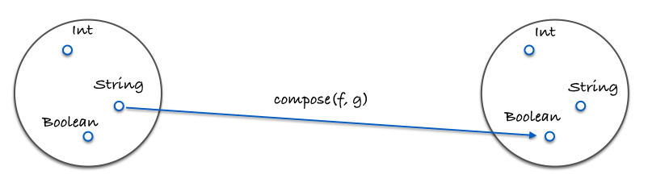

# 第 05 章：用组合来编程

## 函数饲养

这就是 `compose`：

```js
const compose = (...fns) => (...args) => fns.reduceRight((res, fn) => [fn.call(null, ...res)], args)[0];
```

……别怕！这是 _compose_ 的九千级超级赛亚人形态。为了方便推理，咱们先把那个变参实现丢到一边，考虑一个能把两个函数组合起来的更简单形式。等这个你脑子转过弯了，就可以把抽象再往前推，权当它对任意多个函数都成立（我们甚至可以证明这一点）！
亲爱的读者，这儿有个对你更友好的 _compose_：

```js
const compose2 = (f, g) => x => f(g(x));
```

`f` 和 `g` 是函数，`x` 是在它们之间被“管道输送”的值。

组合的感觉就像在搞函数饲养。你，函数的饲养员，挑两个你想把特性结合起来的函数，把它们揉巴揉巴，繁育出一个全新的函数。用法如下：

```js
const toUpperCase = x => x.toUpperCase();
const exclaim = x => `${x}!`;
const shout = compose(exclaim, toUpperCase);

shout('send in the clowns'); // "SEND IN THE CLOWNS!"
```

两个函数组合之后返回一个新函数。这完全说得通：把某个类型（这里指函数）的两个单元组合起来，理应得到这个类型的一个新单元。你不会把两块乐高拼在一起，结果拼出一根林肯积木。这背后是有理论的，有一条底层的定律，时候到了我们自会发现。

在我们对 `compose` 的定义里，`g` 会先于 `f` 执行，形成从右到左的数据流。这比嵌套一大堆函数调用可读多了。没有 compose 的话，上面那句就得写成：

```js
const shout = x => exclaim(toUpperCase(x));
```

我们不再从里往外读，而是从右往左跑，我寻思这算是朝左迈了一步吧（嘘——！）。来看一个顺序很重要的例子：

```js
const head = x => x[0];
const reverse = reduce((acc, x) => [x, ...acc], []);
const last = compose(head, reverse);

last(['jumpkick', 'roundhouse', 'uppercut']); // 'uppercut'
```

`reverse` 会把列表掉个个儿，`head` 则取走开头那一项。这样我们就得到一个管用（虽然低效）的 `last` 函数。组合里函数的先后顺序，到这儿应该已经明摆着了。我们当然可以定义一个从左往右的版本，但眼下这个写法更贴近数学上的写法。没错，组合这玩意儿是直接从数学书里搬来的。其实，现在是时候看看一条对任何组合都成立的性质了。

```js
// 结合律
compose(f, compose(g, h)) === compose(compose(f, g), h);
```

组合满足结合律，意思是无论你怎么把其中两个括在一起，结果都一样。所以，假如我们想把字符串变成大写，可以这么写：

```js
compose(toUpperCase, compose(head, reverse));
// 或者
compose(compose(toUpperCase, head), reverse);
```

既然怎么给 `compose` 的调用分组都无所谓，结果自然相同。这就允许我们写一个变参的 compose，像下面这样用：

```js
// 以前我们得写两个 compose，但既然它满足结合律，
// 我们就可以塞给 compose 任意多个函数，让它自己决定怎么分组。
const arg = ['jumpkick', 'roundhouse', 'uppercut'];
const lastUpper = compose(toUpperCase, head, reverse);
const loudLastUpper = compose(exclaim, toUpperCase, head, reverse);

lastUpper(arg); // 'UPPERCUT'
loudLastUpper(arg); // 'UPPERCUT!'
```

套用结合律给了我们这份灵活，也给了我们“结果肯定等价”的安心。稍微复杂一点的变参定义，收录在本书的配套支持库里，也是你在 [lodash][lodash-website]、[underscore][underscore-website] 和 [ramda][ramda-website] 这类库中会看到的常规写法。

结合律还有个讨人喜欢的妙处：任何一组函数都可以被抽出来，打包成它们专属的组合。咱们拿前面那个例子玩玩重构：

```js
const loudLastUpper = compose(exclaim, toUpperCase, head, reverse);

// -- 或者 -------------------------------------------------------------

const last = compose(head, reverse);
const loudLastUpper = compose(exclaim, toUpperCase, last);

// -- 或者 -------------------------------------------------------------

const last = compose(head, reverse);
const angry = compose(exclaim, toUpperCase);
const loudLastUpper = compose(angry, last);

// 还有更多变体……
```

这里没有标准答案——我们不过是随心所欲地把乐高拼来拼去罢了。通常最好按照可复用的方式分组，比如 `last` 和 `angry`。如果你熟悉 Fowler 的《[重构][refactoring-book]》，大概会认出这个过程就是“[提炼函数][extract-function-refactor]”……只不过没有那一大堆对象状态要操心。

## 无值风格

无值风格（pointfree）的意思是，你永远不必说出你的数据。抱歉，口误。它的意思是：函数从不提及自己所操作的数据。一等函数（first-class function）、柯里化（currying）和组合三者配合默契，就造出了这种风格。

> 提示：`replace` 和 `toLowerCase` 的无值版本，定义在[附录 C：
> 无值风格工具函数](./appendix_c.md)里。别客气，去瞄一眼吧！

```js
// 不是无值风格，因为我们提到了数据：word
const snakeCase = word => word.toLowerCase().replace(/\s+/ig, '_');

// 无值风格
const snakeCase = compose(replace(/\s+/ig, '_'), toLowerCase);
```

看到我们是怎么部分应用（partial application） `replace` 的了吗？我们做的就是让数据从一个个只收一个参数的函数里流过去。柯里化让我们能把每个函数预备好，让它只管接住数据、处理一下、再往下传。另外值得注意的一点是：在无值版本里，我们构造函数时压根儿不需要数据；而在有值版本里，我们得先把 `word` 准备好，然后才能干别的。

再看一个例子。

```js
// 不是无值风格，因为我们提到了数据：name
const initials = name => name.split(' ').map(compose(toUpperCase, head)).join('. ');

// 无值风格
// 注意：这里我们用附录里的 'intercalate'，而不是第 09 章介绍的 'join'！
const initials = compose(intercalate('. '), map(compose(toUpperCase, head)), split(' '));

initials('hunter stockton thompson'); // 'H. S. T'
```

无值代码又一次帮我们甩掉多余的名字，让代码保持简洁、通用。无值风格是检验函数式代码的一块好试金石，因为它能让我们知道：手里这些函数足够小，都是从输入到输出。比方说，你没法把一个 while 循环拿去组合。不过要当心，无值风格是双刃剑，有时候反而会掩盖意图。不是所有函数式代码都得无值，这没关系。能无值就无值，不能就老老实实用普通函数。

## 调试
一个常见的错误，是拿 `map` 这种接收两个参数的函数直接去组合，却没先做部分应用。

```js
// 错——结果我们喂给 angry 一个数组，还把 map 部分应用成了鬼知道什么东西。
const latin = compose(map, angry, reverse);

latin(['frog', 'eyes']); // error

// 对——每个函数都只期待 1 个参数。
const latin = compose(map(angry), reverse);

latin(['frog', 'eyes']); // ['EYES!', 'FROG!'])
```

如果你调试组合时卡住了，可以用这个有用但不纯的 trace 函数看看发生了什么。

```js
const trace = curry((tag, x) => {
  console.log(tag, x);
  return x;
});

const dasherize = compose(
  intercalate('-'),
  toLower,
  split(' '),
  replace(/\s{2,}/ig, ' '),
);

dasherize('The world is a vampire');
// TypeError: Cannot read property 'apply' of undefined
```

这里有问题，咱们 `trace` 一下

```js
const dasherize = compose(
  intercalate('-'),
  toLower,
  trace('after split'),
  split(' '),
  replace(/\s{2,}/ig, ' '),
);

dasherize('The world is a vampire');
// after split [ 'The', 'world', 'is', 'a', 'vampire' ]
```

啊哈！我们得给这个 `toLower` 套上 `map`，因为它现在处理的是一个数组。

```js
const dasherize = compose(
  intercalate('-'),
  map(toLower),
  split(' '),
  replace(/\s{2,}/ig, ' '),
);

dasherize('The world is a vampire'); // 'the-world-is-a-vampire'
```

`trace` 函数让我们能在某个点上查看数据，方便调试。Haskell 和 PureScript 这类语言也有类似的函数，让开发更省心。

组合将成为我们构造程序的工具，而且运气不错，它背后有一门强大的理论撑腰，保证事情会顺顺当当。咱们来仔细瞧瞧这门理论。


## 范畴论

范畴论（category theory）是数学中一个抽象的分支，能把集合论、类型论、群论、逻辑学等好几个不同分支里的概念形式化。它主要跟对象、态射（morphism）和变换打交道，这跟编程的对应关系相当紧密。下面这张图展示了同一批概念在各个理论里分别是什么样子。



抱歉，我不是有意吓你。我并不指望你跟这些概念个个都混得烂熟。我的用意是让你看看这里头重复的东西有多少，这样你就明白范畴论为什么想把它们统一起来了。

在范畴论里，我们有种东西叫……范畴。它被定义成具有以下组成部分的一个汇集：

  * 一组对象
  * 一组态射
  * 态射上的一种组合概念
  * 一个特别的态射，叫做恒等（identity）

范畴论抽象得很，能给很多东西建模，不过咱们把它用到类型和函数上——这才是眼下我们关心的。

**一组对象**
对象就是数据类型。比如 ``String``、``Boolean``、``Number``、``Object`` 等等。我们常常把数据类型看成所有可能取值构成的集合。你可以把 ``Boolean`` 看成 `[true, false]` 这个集合，把 ``Number`` 看成所有可能数值构成的集合。把类型当成集合很有用，因为这样我们就能用集合论来对付它们。


**一组态射**
态射就是我们日常用的标准纯函数（pure function）。

**态射上的一种组合概念**
这个嘛，你可能已经猜到了，就是我们刚到手的新玩具——`compose`。我们讨论过，`compose` 函数满足结合律，这可不是巧合，因为在范畴论里，任何组合都必须满足这条性质。

下面这张图演示了组合：




下面是一个具体的代码例子：

```js
const g = x => x.length;
const f = x => x === 4;
const isFourLetterWord = compose(f, g);
```

**一个特别的态射，叫做恒等**
咱们来介绍一个有用的函数，叫 `id`。这函数干的事，就是接过一点输入，再原封不动地吐还给你。瞧瞧：

```js
const id = x => x;
```

你可能会问自己：“这鬼东西到底有什么用？”后面的章节里我们会大量用到这个函数，不过眼下，你就把它当成一个能顶替我们值的函数——一个伪装成日常数据的函数。

`id` 必须跟 compose 和睦相处。下面这条性质，对每个一元函数（unary：只接收一个参数的函数）f 都永远成立：

```js
// 恒等律
compose(id, f) === compose(f, id) === f;
// true
```

嘿，这跟数字上的恒等律一模一样嘛！要是你没立刻看明白，就花点时间琢磨琢磨。领会一下那种徒劳感。很快我们就会看到 `id` 被到处使用，不过现在你只需知道：它是一个能顶替某个给定值的函数。写无值风格的代码时，这特别好用。

好啦，一个由类型和函数构成的范畴，就是这么回事。如果这是你头一回接触，我猜你对“范畴是什么”“它有什么用”还有点糊里糊涂。这本书后面我们会在这份知识上继续添砖加瓦。至于现在，在本章，在这一行，你至少能看出它给我们在组合方面提供了一点智慧——也就是结合律和恒等律这两条性质。

你问还有别的什么范畴？嗯，我们可以给有向图定义一个：节点是对象，边是态射，组合就是路径拼接。我们也可以拿数字当对象、把 `>=` 当态射（其实任何偏序或全序都能构成范畴）。范畴多得是，但就本书而言，我们只管上面定义的那一个。咱们在表面上蹭得够久了，得往前走了。


## 小结
组合把我们的函数像一根根管子那样接起来。数据会顺着它该走的路流过我们的应用——毕竟纯函数就是从输入到输出，所以打断这条链就等于不管输出，我们的软件也就废了。

我们把组合奉为高于一切的设计原则。因为它能让我们的应用保持简单、讲得通。范畴论将在应用架构、副作用（side effect）建模和保证正确性方面大显身手。

现在正是把这些东西拿到实践中看看的好时候。咱们来做个示例应用。

[第 06 章：示例应用](ch06.md)

## 练习

在接下来的每个练习里，我们都会考虑具有下面这种结构的 Car 对象：

```js
{
  name: 'Aston Martin One-77',
  horsepower: 750,
  dollar_value: 1850000,
  in_stock: true,
}
```


  
用 `compose()` 重写下面的函数。  
  
  
```js  
const isLastInStock = (cars) => {  
  const lastCar = last(cars);  
  return prop('in_stock', lastCar);  
};  
```  
  
  
  
  
  


---


考虑下面这个函数：

```js
const average = xs => reduce(add, 0, xs) / xs.length;
```

  
用辅助函数 `average`，把 `averageDollarValue` 重构成一个组合。  
  
  
```js  
const averageDollarValue = (cars) => {  
  const dollarValues = map(c => c.dollar_value, cars);  
  return average(dollarValues);  
};  
```  
  
  
  
  
  


---


  
用 `compose()` 和其他函数，以无值风格重构 `fastestCar`。提示，  
`append` 函数也许能派上用场。  
  
  
```js  
const fastestCar = (cars) => {  
  const sorted = sortBy(car => car.horsepower, cars);  
  const fastest = last(sorted);  
  return concat(fastest.name, ' is the fastest');  
};  
```  
  
  
  
  
  

[lodash-website]: https://lodash.com/
[underscore-website]: https://underscorejs.org/
[ramda-website]: https://ramdajs.com/
[refactoring-book]: https://martinfowler.com/books/refactoring.html
[extract-function-refactor]: https://refactoring.com/catalog/extractFunction.html
