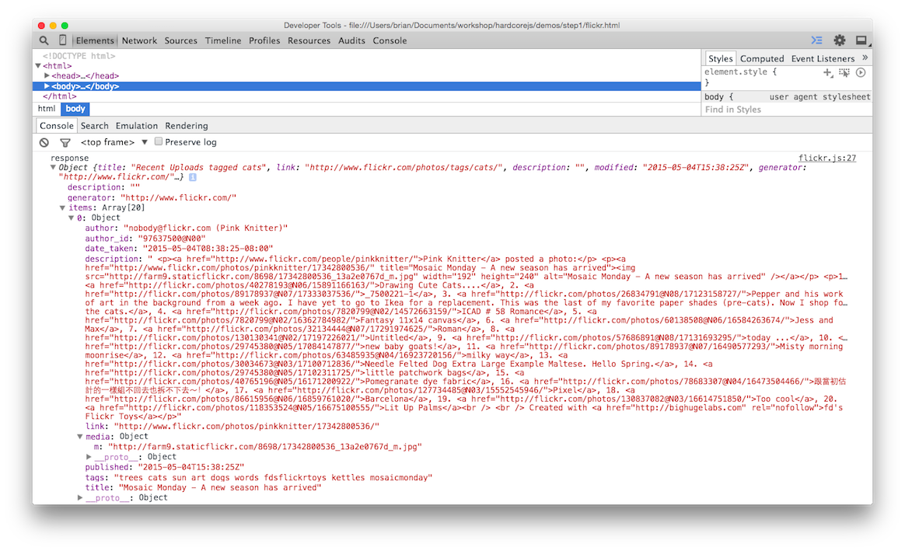
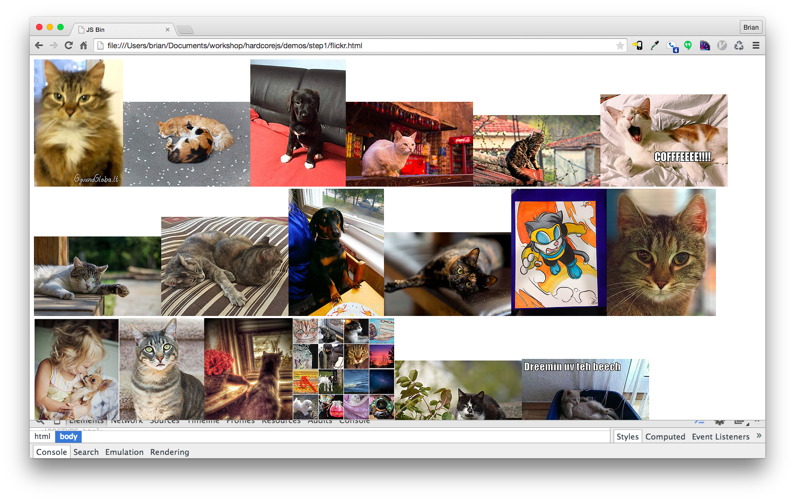

# 第 06 章：示例应用

## 声明式编程

咱们要换换脑子。从现在起，我们不再吩咐计算机该怎么干活，而是写下一份说明书，说明我们想要的结果是什么。我敢打包票，这比一天到晚事无巨细地什么都管要轻松得多。

声明式，跟命令式相对，意思是我们要写表达式，而不是一步一步的指令。

想想 SQL。里头没有“先干这个，再干那个”。只有一条表达式，说明我们想从数据库里要什么。活儿怎么干不由我们决定，由它决定。数据库升级、SQL 引擎优化之后，我们的查询一个字都不用改。因为解释这份说明书、得到同样结果的方式有很多种。

对有些人——包括我自己——来说，声明式编程这个概念一开始很难抓，所以咱们举几个例子找找感觉。

```js
// 命令式
const makes = [];
for (let i = 0; i < cars.length; i += 1) {
  makes.push(cars[i].make);
}

// 声明式
const makes = cars.map(car => car.make);
```

命令式的循环必须先实例化那个数组。解释器得先把这条语句求值完，才能往下走。然后它直接遍历整个汽车列表，手动递增一个计数器，用一场粗俗的显式迭代表演，把它的零零碎碎摊给我们看。

`map` 版本只有一条表达式。它不要求任何求值顺序。map 函数怎么迭代、返回的数组怎么拼装，这里有充分的自由。它规定的是*要什么*，而不是*怎么干*。因此，它才戴上了那条闪亮的声明式绶带。

除了更清楚、更简洁，map 函数还可以随意优化，而我们宝贝的应用代码一个字都不用改。

至于那些心里想着“话是这么说，可命令式循环快多了”的朋友，我建议你先去补补课，搞清楚 JIT 是怎么优化你代码的。这儿有个[很棒的视频，也许能给你点启发](https://www.youtube.com/watch?v=g0ek4vV7nEA)

再来一个例子。

```js
// 命令式
const authenticate = (form) => {
  const user = toUser(form);
  return logIn(user);
};

// 声明式
const authenticate = compose(logIn, toUser);
```

命令式那个版本倒不一定有什么错，但它里头毕竟烤进了一套编码好的一步步求值流程。`compose` 表达式只是陈述了一个事实：认证就是 `toUser` 和 `logIn` 的组合。这同样给支持代码的改动留了余地，也让我们的应用代码成了一份高层次的说明书。

上面这个例子里，求值顺序是规定死的（`toUser` 必须在 `logIn` 之前调用），但有很多场景顺序根本不重要，而用声明式编程很容易把这一点表达出来（这个后面再细说）。

因为我们不必把求值顺序编码进去，声明式编程天生适合并行计算。这一点再加上纯函数（pure function），就是函数式编程（functional programming）在并行未来里是个好选择的原因——要搞出并行/并发的系统，我们其实不需要做什么特别的事。

## 一抹函数式编程的 Flickr 微光

现在我们要用声明式、可组合的方式搭建一个示例应用。眼下我们还是会作弊，用点副作用（side effect），但会把它压到最少，并且跟我们的纯代码库隔开。我们要做一个小浏览器部件，把 flickr 上的图片吸进来再显示出来。先从搭脚手架开始。这是 html：


```html
<!doctype html>
<html lang="en">
  <head>
    <meta charset="utf-8">
    <title>Flickr App</title>
  </head>
  <body>
    <main id="js-main" class="main"></main>
    <script src="https://cdnjs.cloudflare.com/ajax/libs/require.js/2.2.0/require.min.js"></script>
    <script src="main.js"></script>
  </body>
</html>
```

这是 main.js 的骨架：

```js
const CDN = s => `https://cdnjs.cloudflare.com/ajax/libs/${s}`;
const ramda = CDN('ramda/0.21.0/ramda.min');
const jquery = CDN('jquery/3.0.0-rc1/jquery.min');

requirejs.config({ paths: { ramda, jquery } });
requirejs(['jquery', 'ramda'], ($, { compose, curry, map, prop }) => {
  // 应用写在这儿
});
```

我们请来的是 [ramda](https://ramdajs.com)，而不是 lodash 或别的什么工具库。它自带 `compose`、`curry` 等等。我用上了 requirejs，看着可能有点杀鸡用牛刀，但整本书都要用它，保持一致是关键。

这些杂事料理完了，来说需求。我们的应用要做 4 件事。

1. 为我们的搜索词拼出一个 url
2. 发起 flickr api 调用
3. 把返回的 json 变成 html 图片
4. 把它们摆到屏幕上

上面提到了 2 个不纯的操作。你看见了吗？就是从 flickr api 拿数据、以及把东西摆到屏幕上那两处。咱们先把它们定义好，好把它们隔离起来。另外，我会把咱们那个好用的 `trace` 函数加进去，方便调试。

```js
const Impure = {
  getJSON: curry((callback, url) => $.getJSON(url, callback)),
  setHtml: curry((sel, html) => $(sel).html(html)),
  trace: curry((tag, x) => { console.log(tag, x); return x; }),
};
```

这里我们只是把 jQuery 的方法包了一层，让它们柯里化（currying），还把参数顺序换到了更顺手的位置。我用 `Impure` 给它们加了命名空间，这样我们就知道这些是危险函数。以后的例子里，我们会把这两个函数变成纯的。

接下来，我们得拼出一个 url，传给 `Impure.getJSON` 函数。

```js
const host = 'api.flickr.com';
const path = '/services/feeds/photos_public.gne';
const query = t => `?tags=${t}&format=json&jsoncallback=?`;
const url = t => `https://${host}${path}${query(t)}`;
```

用幺半群（monoid，这个后面会学）或者组合子（combinator），可以写出各种花哨又过度复杂的无值风格（pointfree） `url`。我们选择老老实实保留一个可读的版本，用正常的有值方式把这个字符串拼出来。

咱们写一个 app 函数，负责发起调用并把内容摆到屏幕上。

```js
const app = compose(Impure.getJSON(Impure.trace('response')), url);
app('cats');
```

它会调用我们的 `url` 函数，再把得到的字符串传给 `getJSON` 函数——那个函数已经被 `trace` 部分应用（partial application）过了。加载应用，控制台里就会显示 api 调用返回的响应。



我们想拿这份 json 造出图片来。看起来 `mediaUrls` 埋在 `items` 里，再往下是每个 `media` 的 `m` 属性。

不管怎样，要够到这些嵌套属性，我们可以用 ramda 里一个很好用的通用取值函数，叫 `prop`。这儿有个土制版本，让你看明白它是怎么回事：

```js
const prop = curry((property, object) => object[property]);
```

其实这玩意儿相当乏味。我们就是用 `[]` 语法去访问随便什么对象上的属性。拿它去取我们的 `mediaUrls` 吧。

```js
const mediaUrl = compose(prop('m'), prop('media'));
const mediaUrls = compose(map(mediaUrl), prop('items'));
```

拿到 `items` 之后，我们得对它 `map` 一遍，把每个 media url 提取出来。这样就得到一个漂漂亮亮的 `mediaUrls` 数组。把它接到应用上，打印到屏幕上吧。

```js
const render = compose(Impure.setHtml('#js-main'), mediaUrls);
const app = compose(Impure.getJSON(render), url);
```

我们只是做了一个新组合，它会调用 `mediaUrls`，再用结果去设置 `<main>` 的 html。既然除了原始 json 之外终于有东西可渲染了，我们就用 `render` 换掉了 `trace` 调用。这会粗糙地把 `mediaUrls` 显示在 body 里。

最后一步，是把这些 `mediaUrls` 变成货真价实的 `images`。在更大的应用里，我们会用 Handlebars 或 React 这类模板/DOM 库。不过对这个应用来说，我们只需要一个 img 标签，所以还是用 jQuery 吧。

```js
const img = src => $('', { src });
```

jQuery 的 `html` 方法可以接受一个标签数组。我们只需把 mediaUrls 变成图片，再一路送给 `setHtml`。

```js
const images = compose(map(img), mediaUrls);
const render = compose(Impure.setHtml('#js-main'), images);
const app = compose(Impure.getJSON(render), url);
```

大功告成！



这是完工后的脚本：
[include](./exercises/ch06/main.js)

瞧瞧这个。一份漂亮的声明式说明书，说明的是东西*是什么*，而不是它们怎么变成这样。现在我们把每一行都看成一个等式，带着成立的性质。我们可以用这些性质来推理我们的应用，然后重构。

## 有原则的重构

这儿有个可做的优化——我们先对每一项 map 一遍，把它变成 media url，然后又对那些 mediaUrls map 一遍，把它们变成 img 标签。关于 map 和组合，有一条定律：


```js
// map 的组合定律
compose(map(f), map(g)) === map(compose(f, g));
```

我们可以利用这条性质来优化代码。来一次有原则的重构吧。

```js
// 原始代码
const mediaUrl = compose(prop('m'), prop('media'));
const mediaUrls = compose(map(mediaUrl), prop('items'));
const images = compose(map(img), mediaUrls);
```

把我们的 map 排排齐。多亏了等式推理（equational reasoning）和纯粹性，我们可以把对 `mediaUrls` 的调用内联进 `images` 里。

```js
const mediaUrl = compose(prop('m'), prop('media'));
const images = compose(map(img), map(mediaUrl), prop('items'));
```

现在 `map` 排好了，可以套用组合定律了。

```js
/*
compose(map(f), map(g)) === map(compose(f, g));
compose(map(img), map(mediaUrl)) === map(compose(img, mediaUrl));
*/

const mediaUrl = compose(prop('m'), prop('media'));
const images = compose(map(compose(img, mediaUrl)), prop('items'));
```

这下这捣蛋鬼在把每一项变成 img 时只会循环一次了。咱们把那个函数抽出来，让它再好读一点。

```js
const mediaUrl = compose(prop('m'), prop('media'));
const mediaToImg = compose(img, mediaUrl);
const images = compose(map(mediaToImg), prop('items'));
```

## 小结

我们已经看到怎么把新学的本事用在一个虽小但真实的现实应用上。我们用数学框架来推理和重构代码。可错误处理和代码分支怎么办？怎么才能让整个应用都是纯的，而不是仅仅给破坏性函数套个命名空间？怎么才能让应用更安全、更有表达力？这些就是第二部分要解决的问题。

[第 07 章：Hindley-Milner 与我](ch07.md)
