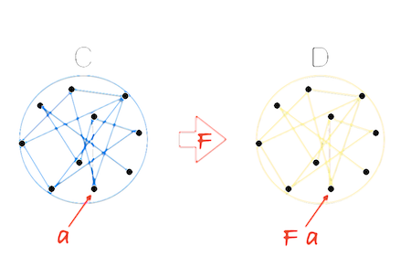
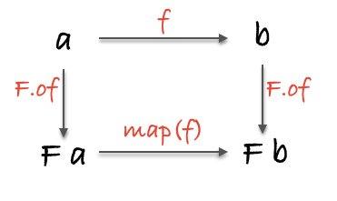
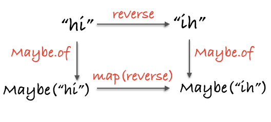

# 第 08 章：保鲜盒

## 威风凛凛的容器


咱们已经见识过怎么写出这样的程序：让数据穿过一连串纯函数（pure function）。它们是对行为的声明式描述。可控制流呢？错误处理呢？异步动作呢？状态呢？还有——我敢说吗——效应？！这一章，我们要去发掘那座地基，上面所有这些好用的抽象，都是建在它上面的。

首先，咱们来造一个容器。这个容器得能装下任意类型的值；一个只装得下木薯布丁的密封袋，基本没什么用。它会是个对象，但我们不会按面向对象的意思给它配上属性和方法。不，我们要把它当成一个宝箱——一个专门捧着咱们宝贵数据的特别盒子。

```js
class Container {
  constructor(x) {
    this.$value = x;
  }
  
  static of(x) {
    return new Container(x);
  }
}
```

这就是咱们的第一个容器。我们费了点心思，给它取名 `Container`。我们会拿 `Container.of` 当构造函数用，省得满世界写那个糟心的 `new` 关键字。`of` 这函数可不止表面上这点本事，不过眼下，你就把它当成把值放进容器的正经办法。

咱们来瞧瞧这个崭新的盒子……

```js
Container.of(3);
// Container(3)

Container.of('hotdogs');
// Container("hotdogs")

Container.of(Container.of({ name: 'yoda' }));
// Container(Container({ name: 'yoda' }))
```

你要是用 node，看到的会是 `{$value: x}`，哪怕咱们手里明明是个 `Container(x)`。Chrome 能把类型好好地打出来，不过无所谓；只要咱们心里清楚 `Container` 长什么样，就不碍事。在某些环境里，只要你乐意，可以覆盖掉 `inspect` 方法，但我们不会那么较真。在这本书里，我们会把概念上的输出写成好像已经覆盖过 `inspect` 的样子，因为不管从教学角度还是审美角度，它都比 `{$value: x}` 有教育意义得多。

往下走之前，有几点得说清楚：

* `Container` 是个只有一个属性的对象。很多容器确实只装一样东西，不过它们并不限于只装一样。我们随随便便就把这个属性命名为 `$value` 了。

* `$value` 不能是某个特定类型，不然咱们的 `Container` 可太对不起这名字了。

* 数据一旦进了 `Container`，就待在里面了。我们*本可以*用 `.$value` 把它掏出来，但那就违背初衷了。

我们为什么要这么干，迟早会像梅森罐一样透亮，不过眼下，先忍忍我。

## 我的第一个函子

等我们的值——不管它是什么——进了容器，我们就需要一种办法，在它身上跑函数。

```js
// (a -> b) -> Container a -> Container b
Container.prototype.map = function (f) {
  return Container.of(f(this.$value));
};
```

哎哟，这不就跟 Array 那个大名鼎鼎的 `map` 一样嘛，只不过咱们手里是 `Container a` 而不是 `[a]`。用法也基本一样：

```js
Container.of(2).map(two => two + 2); 
// Container(4)

Container.of('flamethrowers').map(s => s.toUpperCase()); 
// Container('FLAMETHROWERS')

Container.of('bombs').map(append(' away')).map(prop('length')); 
// Container(10)
```

我们可以在压根儿不离开 `Container` 的情况下跟自己的值打交道。这可太了不起了。容器里的值会被交给 `map` 的函数，我们想怎么摆弄就怎么摆弄，弄完之后它又被送回自己的 `Container` 里妥善保管。正因为始终没离开过 `Container`，我们才能一路 `map` 下去，爱跑什么函数就跑什么函数。甚至还能一边走一边换类型，就像三个例子里最后那个演示的那样。

等等，要是我们一直这么调 `map`，这看着像是某种组合啊！这背后是哪门子数学魔法在作祟？各位，咱们刚刚发现了*函子*（Functor）。

> 函子就是一种实现了 `map`、并且遵守若干定律的类型

没错，*Functor* 说白了就是个带契约的接口。我们本来完全可以把它叫 *Mappable*，可那样一来，*fun* 上哪儿找去？函子来自范畴论（category theory），本章末尾我们会细看这套数学；不过眼下，咱们先来对付这个名字古怪的接口——先养直觉，再看实际用法。

我们到底有什么理由，要把一个值塞进瓶子里，再用 `map` 去够它？换个更好的问法，答案自己就露出来了：让容器替我们套用函数，我们图的是什么？图的是函数套用这件事的抽象。当我们 `map` 一个函数时，我们是在请容器类型替我们运行它。这概念确实非常强大。

## 薛定谔的 Maybe


`Container` 相当无聊。事实上，它通常被叫作 `Identity`，作用跟咱们的 `id` 函数差不多（这里又有一层数学联系，时机到了我们再聊）。不过，还有别的函子——也就是那些长得像容器、带一个正经 `map` 函数的类型——它们能在 `map` 的时候提供有用的行为。咱们现在就定义一个。

> 完整实现见[附录 B](./appendix_b.md#maybe)

```js
class Maybe {
  static of(x) {
    return new Maybe(x);
  }

  get isNothing() {
    return this.$value === null || this.$value === undefined;
  }

  constructor(x) {
    this.$value = x;
  }

  map(fn) {
    return this.isNothing ? this : Maybe.of(fn(this.$value));
  }

  inspect() {
    return this.isNothing ? 'Nothing' : `Just(${inspect(this.$value)})`;
  }
}
```

现在，`Maybe` 看着很像 `Container`，只有一点小改动：它在调用传入的函数之前，会先检查自己有没有值。这样就绕开了那些讨人厌的 null，我们照样 `map` 我们的（注意，这个实现为了教学做了简化）。

```js
Maybe.of('Malkovich Malkovich').map(match(/a/ig));
// Just(True)

Maybe.of(null).map(match(/a/ig));
// Nothing

Maybe.of({ name: 'Boris' }).map(prop('age')).map(add(10));
// Nothing

Maybe.of({ name: 'Dinah', age: 14 }).map(prop('age')).map(add(10));
// Just(24)
```

注意，当我们对着 null 值 `map` 函数时，应用并没有炸出一堆错误。这是因为 `Maybe` 每套用一个函数，都会不厌其烦地检查一遍有没有值。

这种点号写法完全没问题，也很函数式，但出于第一部分提过的那些理由，我们想保住无值风格（pointfree）。巧的是，`map` 完全有能力把活儿转交给它收到的任何一个函子：

```js
// map :: Functor f => (a -> b) -> f a -> f b
const map = curry((f, anyFunctor) => anyFunctor.map(f));
```

这很讨人喜欢，因为我们可以照旧玩组合，`map` 会如期工作。Ramda 的 `map` 也是如此。需要教学效果时我们就用点号写法，图方便时就用无值版本。你注意到了吗？我偷偷往类型签名（type signature）里塞了点额外记号。那个 `Functor f =>` 是在说，`f` 必须是个函子。算不上难，不过我觉得该提一嘴。

## 用例

在真实的代码丛林里，我们通常会在那些可能拿不到返回值的函数里见到 `Maybe`。

```js
// safeHead :: [a] -> Maybe(a)
const safeHead = xs => Maybe.of(xs[0]);

// streetName :: Object -> Maybe String
const streetName = compose(map(prop('street')), safeHead, prop('addresses'));

streetName({ addresses: [] });
// Nothing

streetName({ addresses: [{ street: 'Shady Ln.', number: 4201 }] });
// Just('Shady Ln.')
```

`safeHead` 就像我们平常那个 `head`，只不过多了类型安全。当 `Maybe` 被引进代码里，有件怪事会发生：我们被迫去应付那些鬼鬼祟祟的 `null` 值。`safeHead` 函数对自己的可能失败很诚实、很坦率——这事儿真没什么见不得人的——所以它返回一个 `Maybe`，把这件事告诉我们。可我们不只是被*告知*了：想拿到那个值，我们就得被迫 `map`，谁让它被藏在 `Maybe` 对象里呢。本质上，这就是由 `safeHead` 函数自己强制执行的 `null` 检查。现在咱们晚上能睡得更香了，因为知道 `null` 值不会在我们最想不到的时候，伸出一颗丑陋的、被砍下来的脑袋。这类 API 能把一个纸糊加图钉的脆弱应用，升级成木头加钉子的结实货。它们能保证软件更安全。


有时候，函数会显式地返回一个 `Nothing` 来表示失败。比如：

```js
// withdraw :: Number -> Account -> Maybe(Account)
const withdraw = curry((amount, { balance }) =>
  Maybe.of(balance >= amount ? { balance: balance - amount } : null));

// 这个函数是假想的，这里没有实现……别处也没有。
// updateLedger :: Account -> Account 
const updateLedger = account => account;

// remainingBalance :: Account -> String
const remainingBalance = ({ balance }) => `Your balance is $${balance}`;

// finishTransaction :: Account -> String
const finishTransaction = compose(remainingBalance, updateLedger);


// getTwenty :: Account -> Maybe(String)
const getTwenty = compose(map(finishTransaction), withdraw(20));

getTwenty({ balance: 200.00 }); 
// Just('Your balance is $180')

getTwenty({ balance: 10.00 });
// Nothing
```

要是咱们现金不够，`withdraw` 会冲我们鼻子一翘，返回 `Nothing`。这函数还把自己的喜怒无常写在脸上，叫我们别无选择，只能在后面把所有东西都 `map` 一遍。区别在于，这里的 `null` 是有意为之。我们拿回来的不是 `Just('..')`，而是表示失败的 `Nothing`，应用也就实实在在地停在了原地。这点值得记牢：`withdraw` 一旦失败，`map` 就会把后面的计算一刀切断，因为它压根儿不会去跑被映射的函数，也就是 `finishTransaction`。这恰恰是想要的行为——钱没取成功，我们可不想去更新账本，也不想显示什么新余额。

## 把值放出来

有件事大家常常忽略：一条链子总有到头的时候；总会有一个产生效应的函数，把 JSON 发出去，或者打到屏幕上，或者改动我们的文件系统，诸如此类。我们没法用 `return` 把输出交付出去，必须跑上某个函数，把它送进这个世界。我们可以把它说成一句禅宗公案：“一个程序若无可观测的效应，它到底跑没跑？”它是跑给自己看、跑得心满意足吗？我怀疑它只是烧掉几个时钟周期，然后回去接着睡了……

我们应用的活儿，是取来数据、变换数据、带着它一路走下去，直到该说再见的时候；而那个说再见的函数也可以被 `map`，于是值压根儿不必离开它容器的温暖子宫。说真的，一个常见的错误，就是千方百计想把值从 `Maybe` 里弄出来，好像里面那个可能存在的值会突然显形，然后一切都被原谅了似的。我们必须明白，这可能是代码的某个分支——在那里，我们的值根本不在场，没法去完成它的天命。我们的代码很像薛定谔的猫，同时处于两种状态，而且应当一直保持这个事实，直到最后一个函数。这让我们的代码明明是逻辑分支，读起来却是一条线性的流。

不过，还是有个逃生舱口的。要是我们宁愿返回一个自定义的值然后继续往下走，可以用一个叫 `maybe` 的小助手。

```js
// maybe :: b -> (a -> b) -> Maybe a -> b
const maybe = curry((v, f, m) => {
  if (m.isNothing) {
    return v;
  }

  return f(m.$value);
});

// getTwenty :: Account -> String
const getTwenty = compose(maybe('You\'re broke!', finishTransaction), withdraw(20));

getTwenty({ balance: 200.00 }); 
// 'Your balance is $180.00'

getTwenty({ balance: 10.00 }); 
// 'You\'re broke!'
```

现在我们要么返回一个固定值（类型跟 `finishTransaction` 返回的一样），要么欢欢喜喜地把交易收尾，不再有 `Maybe` 掺和。用 `maybe` 的时候，我们看到的东西相当于一条 `if/else` 语句；而用 `map` 的时候，对应的命令式写法是：`if (x !== null) { return f(x) }`。

`Maybe` 一登场，最初总让人有点不舒服。Swift 和 Scala 的用户懂我意思，它早就披着 `Option(al)` 的马甲，烤进了核心库里。真被逼着时时刻刻处理 `null` 检查（而且有些时候我们百分之百确定值就在那儿），大多数人忍不住觉得这活儿有点累人。不过时间一长，它会变成第二天性，你多半还会欣赏这份安全。毕竟大多数时候，它能挡住偷工减料，还能保住我们的小命。

写不安全的软件，就像小心翼翼地把每只鸡蛋涂上粉彩，然后抡圆了往车流里扔；就像用三只小猪警告过的那种材料去盖养老院。给函数添点安全措施对咱们大有好处，而 `Maybe` 正好帮我们干这个。

要是不提一句，我可就失职了：“真正的”实现会把 `Maybe` 拆成两个类型：一个装“有东西”，一个装“没东西”。这样才能在 `map` 里遵守参数化性质，让 `null` 和 `undefined` 这类值也照样能被映射，函子里那个值的全称量化也才得到尊重。你常常会看到 `Some(x) / None` 或者 `Just(x) / Nothing` 这样的类型，而不是一个自己对着值做 `null` 检查的 `Maybe`。

## 纯粹的错误处理


说出来可能吓你一跳：`throw/catch` 并不怎么纯。错误一抛出，我们不是返回一个输出值，而是拉响了警报！函数发起了攻击，喷出成千上万个 0 和 1，像盾牌和长矛一样，跟那个闯进来的输入打一场电子战。有了新朋友 `Either`，我们不必再对输入宣战，可以回一句客客气气的话。来看：

> 完整实现见[附录 B](./appendix_b.md#either)

```js
class Either {
  static of(x) {
    return new Right(x);
  }

  constructor(x) {
    this.$value = x;
  }
}

class Left extends Either {
  map(f) {
    return this;
  }

  inspect() {
    return `Left(${inspect(this.$value)})`;
  }
}

class Right extends Either {
  map(f) {
    return Either.of(f(this.$value));
  }

  inspect() {
    return `Right(${inspect(this.$value)})`;
  }
}

const left = x => new Left(x);
```

`Left` 和 `Right` 是同一个抽象类型的两个子类，那个抽象类型我们叫 `Either`。创建 `Either` 超类的那套仪式我略过了，因为咱们根本不会用到它，但知道有这回事总是好的。那么，除了这两个类型，这里也没什么新东西。看看它们怎么行事：

```js
Either.of('rain').map(str => `b${str}`); 
// Right('brain')

left('rain').map(str => `It's gonna ${str}, better bring your umbrella!`); 
// Left('rain')

Either.of({ host: 'localhost', port: 80 }).map(prop('host'));
// Right('localhost')

left('rolls eyes...').map(prop('host'));
// Left('rolls eyes...')
```

`Left` 是那种青春叛逆期的类型，压根儿不理我们要 `map` 它的请求。`Right` 则跟 `Container`（又名 Identity）一个样。这威力来自它能把一条错误信息塞进 `Left` 里。

假设我们有个不一定能成功的函数。不如来算算：从出生日期算出年龄。我们本可以用 `Nothing` 表示失败、给程序分个岔，可那没告诉我们多少信息。也许我们还想知道它到底为什么失败。那咱们用 `Either` 来写。

```js
const moment = require('moment');

// getAge :: Date -> User -> Either(String, Number)
const getAge = curry((now, user) => {
  const birthDate = moment(user.birthDate, 'YYYY-MM-DD');

  return birthDate.isValid()
    ? Either.of(now.diff(birthDate, 'years'))
    : left('Birth date could not be parsed');
});

getAge(moment(), { birthDate: '2005-12-12' });
// Right(9)

getAge(moment(), { birthDate: 'July 4, 2001' });
// Left('Birth date could not be parsed')
```

现在，跟 `Nothing` 一样，一旦返回 `Left`，我们的应用就短路了。区别在于，这回我们知道程序为什么脱轨了。有件事值得留意：我们返回的是 `Either(String, Number)`，它的左值是个 `String`，`Right` 是个 `Number`。这个类型签名有点随意，因为我们还没花工夫去定义真正的 `Either` 超类，不过从这个类型里我们能学到不少东西。它告诉我们，我们要么拿回一条错误信息，要么拿回年龄。

```js
// fortune :: Number -> String
const fortune = compose(concat('If you survive, you will be '), toString, add(1));

// zoltar :: User -> Either(String, _)
const zoltar = compose(map(console.log), map(fortune), getAge(moment()));

zoltar({ birthDate: '2005-12-12' });
// 'If you survive, you will be 10'
// Right(undefined)

zoltar({ birthDate: 'balloons!' });
// Left('Birth date could not be parsed')
```

当 `birthDate` 有效时，程序会把它的神秘预言打到屏幕上让咱们瞻仰。否则，我们拿到一个 `Left`，错误信息明明白白，只是仍然被收在它的容器里。这跟抛出错误的效果一样，只不过它心平气和、温文尔雅，不像出了事就乱发脾气、像小孩一样尖叫那样。

在这个例子里，我们根据出生日期是否有效，在逻辑上给控制流分了岔，可它读起来却像一段从右到左的线性运动，而不是在条件语句的大括号里爬上爬下。平常我们会把 `console.log` 搬到 `zoltar` 函数外面，在调用的时候再 `map` 它，不过看看 `Right` 这条分支有何不同也挺有帮助。我们在右分支的类型签名里用 `_` 表示这是个该被忽略的值（在某些浏览器里，要想把它当一等函数用，得写成 `console.log.bind(console)`）。

我想借这个机会指出一件你可能漏掉的事：`fortune` 尽管在这个例子里跟 `Either` 一起用，可它对周围晃悠的函子一无所知。前一个例子里的 `finishTransaction` 也是如此。调用的时候，一个函数可以被 `map` 包住，用不严谨的话说，这就把它从一个“不带函子的”函数变成了“带函子的”函数。这个过程我们叫*提升*（lifting）。函数跟普通数据类型打交道，通常比对容器类型更自在，需要的时候再把它*提升*进合适的容器。这样得来的函数更简单、更好复用，还能按需改造成适用于任何函子的样子。

`Either` 特别适合验证这类随手的错误，也适合缺文件、断 socket 这类更严重的、让演出直接停摆的错误。不妨试着把前面某些 `Maybe` 的例子换成 `Either`，好给出更清楚的反馈。

不过，我得承认，只把 `Either` 介绍成“装错误信息的容器”，实在是委屈它了。它把逻辑或（也就是 `||`）编码进了类型里。它还编码了范畴论里*余积*（Coproduct）的概念——这本书不会深入讲，但非常值得你自己去读一读，因为里面有不少性质可以利用。它是标准的和类型（或者说集合的不交并），因为它可能住进的居民数量，正是两个被包含类型的数量之和（我知道这有点含糊其辞，所以这儿有[一篇很棒的文章](https://www.schoolofhaskell.com/school/to-infinity-and-beyond/pick-of-the-week/sum-types)）。`Either` 能当的东西多着呢，但作为一个函子，它的用途就在错误处理上。

跟 `Maybe` 一样，我们也有个小号的 `either`，行为类似，但它收两个函数，而不是一个函数加一个固定值。每个函数都应当返回同一个类型：

```js
// either :: (a -> c) -> (b -> c) -> Either a b -> c
const either = curry((f, g, e) => {
  let result;

  switch (e.constructor) {
    case Left:
      result = f(e.$value);
      break;

    case Right:
      result = g(e.$value);
      break;

    // 没有 default 分支
  }

  return result;
});

// zoltar :: User -> _
const zoltar = compose(console.log, either(id, fortune), getAge(moment()));

zoltar({ birthDate: '2005-12-12' });
// 'If you survive, you will be 10'
// undefined

zoltar({ birthDate: 'balloons!' });
// 'Birth date could not be parsed'
// undefined
```

终于，那个神神秘秘的 `id` 函数派上用场了。它只是把 `Left` 里的值鹦鹉学舌地传回去，好让错误信息送到 `console.log` 那儿。我们让 `getAge` 从内部强制处理错误，于是这个算命应用更结实了。我们要么像相面先生跟你击个掌那样，把一记硬邦邦的真相糊在用户脸上，要么就接着走我们的流程。到这儿，我们就可以动身去看一种完全不同的函子了。

## 老麦克唐纳有个效应……


在讲纯粹性的那一章，我们见过一个古怪的纯函数例子。那个函数里包着副作用（side effect），但我们把它包在另一个函数里，于是封它为纯。这儿还有一个这样的例子：

```js
// getFromStorage :: String -> (_ -> String)
const getFromStorage = key => () => localStorage[key];
```

要是我们没把它的五脏六腑包进另一个函数，`getFromStorage` 的输出就会随外部情况而变。有了这层结实的包装，同样的输入永远得到同样的输出：一个函数，一调用它，就会从 `localStorage` 里取出某个特定的条目。就这么着（也许再念几遍圣母经），我们的良心就干净了，一切都被原谅。

只可惜，这玩意儿现在并不怎么有用，对吧。就像包装还没拆的收藏版手办，我们其实没法拿它来玩。要是能有办法伸进容器里，够到它的内容就好了……于是 `IO` 登场。

```js
class IO {
  static of(x) {
    return new IO(() => x);
  }

  constructor(fn) {
    this.$value = fn;
  }

  map(fn) {
    return new IO(compose(fn, this.$value));
  }

  inspect() {
    return `IO(${inspect(this.$value)})`;
  }
}
```

`IO` 跟前面那些函子的不同之处在于，它的 `$value` 永远是个函数。不过我们并不把它的 `$value` 当成函数看——那只是个实现细节，最好无视它。真正发生的事，跟我们在 `getFromStorage` 例子里看到的一模一样：`IO` 把不纯的动作抓进一个函数包装里，从而把它延迟了。因此，我们认为 `IO` 装的是那个被包装动作的返回值，而不是包装本身。这一点在 `of` 函数里很明显：我们拿到一个 `IO(x)`，那个 `IO(() => x)` 只是为了避开求值。注意，为了读起来省事，我们会把 `IO` 里假想的值当作结果写出来；可实际上，在真正放出效应之前，你根本说不准这个值是什么！

看看它怎么用：

```js
// ioWindow :: IO Window
const ioWindow = new IO(() => window);

ioWindow.map(win => win.innerWidth);
// IO(1430)

ioWindow
  .map(prop('location'))
  .map(prop('href'))
  .map(split('/'));
// IO(['http:', '', 'localhost:8000', 'blog', 'posts'])


// $ :: String -> IO [DOM]
const $ = selector => new IO(() => document.querySelectorAll(selector));

$('#myDiv').map(head).map(div => div.innerHTML);
// IO('I am some inner html')
```

这里，`ioWindow` 是个货真价实的 `IO`，我们可以直接往上 `map`；而 `$` 是个函数，调用之后才返回一个 `IO`。我把*概念上的*返回值写了出来，好更好地表达 `IO`，可实际上它永远是 `{ $value: [Function] }`。当我们往 `IO` 上 `map` 时，我们把这个函数接到一段组合的末尾，这段组合接着又成了新的 `$value`，依此类推。被映射的函数并不会运行，它们只是被钉在我们正一点点垒起来的计算的末端，一个函数接一个函数，就像小心翼翼地摆多米诺骨牌，谁也不敢去碰倒第一张。这结果让人想起“四人帮”的命令模式，或者一个队列。

花点时间，把你那点函子直觉召唤出来。只要看穿实现细节，我们就能在任何一个容器上 `map` 得舒舒服服，不管它有什么怪癖和脾气。这份近乎通灵的本事，得感谢函子定律——本章末尾我们会去探个究竟。无论如何，我们终于能跟不纯的值玩耍，而不必牺牲珍贵的纯粹性了。

现在，我们把野兽关进笼子了，但总得在某个时刻把它放出来。往 `IO` 上 `map` 已经堆出了一个了不得的不纯计算，跑去执行它，肯定会搅得天下大乱。那么，我们能在哪儿、在什么时候扣下扳机？有没有可能既跑了 `IO`，又能穿着白纱去结婚？答案是：能，只要把责任推给调用方的代码。我们的纯代码尽管暗地里策划了一堆阴谋诡计，却依然清白无辜；真正执行效应的担子，落在调用者肩上。来看个例子，把这点落到实处。

```js
// url :: IO String
const url = new IO(() => window.location.href);

// toPairs :: String -> [[String]]
const toPairs = compose(map(split('=')), split('&'));

// params :: String -> [[String]]
const params = compose(toPairs, last, split('?'));

// findParam :: String -> IO Maybe [String]
const findParam = key => map(compose(Maybe.of, find(compose(eq(key), head)), params), url);

// -- 不纯的调用代码 ----------------------------------------------

// 调用 $value() 让它跑起来！
findParam('searchTerm').$value();
// Just(['searchTerm', 'wafflehouse'])
```

我们的库把 `url` 包进一个 `IO`，把锅甩给调用者，自己的手就干净了。你可能也注意到了，我们把容器叠起来了；出现一个 `IO(Maybe([x]))` 完全合情合理，这已经深到三层函子了（`Array` 绝对算得上是个可映射的容器类型），表达力非同小可。

有件事一直让我心里别扭，得立马纠正：`IO` 的 `$value` 其实并不是它装的值，它也不是什么私有属性。它是手榴弹上的拉环，本来就该由调用者用最公开的方式拔掉。咱们把这个属性改名为 `unsafePerformIO`，好提醒使用者它有多危险。

```js
class IO {
  constructor(io) {
    this.unsafePerformIO = io;
  }

  map(fn) {
    return new IO(compose(fn, this.unsafePerformIO));
  }
}
```

好了，好多了。现在我们的调用代码变成 `findParam('searchTerm').unsafePerformIO()`，对应用的用户（以及读者）来说，清楚得像白天一样。

`IO` 会是个忠诚的伙伴，帮我们驯服那些野性难驯的不纯动作。接下来，我们看一个精神上相近、但用途大不相同的类型。


## 异步任务

回调就是那条越走越窄、通向地狱的螺旋楼梯。它们是 M.C. 埃舍尔设计的控制流。每嵌套一层回调，都挤在大括号和圆括号搭成的攀爬架中间，感觉就像在深牢大狱里跳林波舞（还能再低到哪儿去？！）。光是想想，我就一阵幽闭恐惧的寒意。别担心，我们对付异步代码有更好的办法，而且它是以字母“F”开头的。

它的内部实现有点太复杂，没法在这儿全倒在纸面上，所以我们会用 Quildreen Motta 那个了不起的 [Folktale](https://folktale.origamitower.com/) 里的 `Data.Task`（以前叫 `Data.Future`）。见识一下用法：

```js
// -- Node readFile 示例 ------------------------------------------

const fs = require('fs');

// readFile :: String -> Task Error String
const readFile = filename => new Task((reject, result) => {
  fs.readFile(filename, (err, data) => (err ? reject(err) : result(data)));
});

readFile('metamorphosis').map(split('\n')).map(head);
// Task('One morning, as Gregor Samsa was waking up from anxious dreams, he discovered that
// in bed he had been changed into a monstrous verminous bug.')


// -- jQuery getJSON 示例 -----------------------------------------

// getJSON :: String -> {} -> Task Error JSON
const getJSON = curry((url, params) => new Task((reject, result) => {
  $.getJSON(url, params, result).fail(reject);
}));

getJSON('/video', { id: 10 }).map(prop('title'));
// Task('Family Matters ep 15')


// -- 默认的最小上下文 ----------------------------------------

// 普通、不带未来感的值也可以放进去
Task.of(3).map(three => three + 1);
// Task(4)
```

我称作 `reject` 和 `result` 的那两个函数，分别是我们的错误回调和成功回调。如你所见，我们只管往 `Task` 上 `map`，跟那个未来的值打交道，就好像它已经在手心里了。到这会儿，`map` 该是老一套了。

你要是熟悉 promise，可能会认出这里的 `map` 就是 `then`，而 `Task` 扮演着我们那个 promise 的角色。不熟 promise 也别慌，反正我们不会用它，因为它不纯；不过这个类比还是成立的。

跟 `IO` 一样，`Task` 会耐心等着我们给它开绿灯，然后才运行。事实上，正因为它等我们的命令，凡是异步的活儿，`IO` 实际上都被 `Task` 吞并了；`readFile` 和 `getJSON` 不需要再套一层 `IO` 容器来保持纯净。更进一步说，我们往 `Task` 上 `map` 的时候，它的工作方式也差不多：我们像是在给未来留下指令，像把一张家务轮值表塞进时间胶囊里——一种技术含量颇高的拖延症行为。

要跑我们的 `Task`，必须调用 `fork` 方法。它的作用类似 `unsafePerformIO`，但顾名思义，它会把我们的进程分叉出去，求值继续进行，而不阻塞我们的线程。这可以有无数种实现方式，用线程之类的；但在这里，它的表现就跟一次普通的异步调用一样，事件循环那个大轮子照转不误。来看看 `fork`：

```js
// -- 纯应用部分 -------------------------------------------------
// blogPage :: Posts -> HTML
const blogPage = Handlebars.compile(blogTemplate);

// renderPage :: Posts -> HTML
const renderPage = compose(blogPage, sortBy(prop('date')));

// blog :: Params -> Task Error HTML
const blog = compose(map(renderPage), getJSON('/posts'));


// -- 不纯的调用代码 ----------------------------------------------
blog({}).fork(
  error => $('#error').html(error.message),
  page => $('#main').html(page),
);

$('#spinner').show();
```

一调用 `fork`，`Task` 就急匆匆跑去找帖子、渲染页面了。与此同时，我们显示一个转圈圈，因为 `fork` 并不等待响应。最后，视 `getJSON` 调用成不成功，我们要么显示一条错误，要么把页面渲染到屏幕上。

花点时间体会一下这里的控制流有多线性。我们只要从下往上、从右往左读就行，尽管程序真正执行时还是会跳来跳去。这让阅读和推理我们的应用，比在回调和错误处理块之间来回弹跳简单多了。

我的天，你瞧瞧，`Task` 把 `Either` 也吞下去了！它必须这么做，才能处理“未来的失败”，因为在异步世界里，我们平常那套控制流不管用。这挺好，它开箱就提供了够用而且纯粹的错误处理。

就算有了 `Task`，我们的 `IO` 和 `Either` 函子也没失业。忍我一下，看一个偏向复杂和假想的例子，不过它对说明问题很有用。

```js
// Postgres.connect :: Url -> IO DbConnection
// runQuery :: DbConnection -> ResultSet
// readFile :: String -> Task Error String

// -- 纯应用部分 -------------------------------------------------

// dbUrl :: Config -> Either Error Url
const dbUrl = ({ uname, pass, host, db }) => {
  if (uname && pass && host && db) {
    return Either.of(`db:pg://${uname}:${pass}@${host}5432/${db}`);
  }

  return left(Error('Invalid config!'));
};

// connectDb :: Config -> Either Error (IO DbConnection)
const connectDb = compose(map(Postgres.connect), dbUrl);

// getConfig :: Filename -> Task Error (Either Error (IO DbConnection))
const getConfig = compose(map(compose(connectDb, JSON.parse)), readFile);


// -- 不纯的调用代码 ----------------------------------------------

getConfig('db.json').fork(
  logErr('couldn\'t read file'),
  either(console.log, map(runQuery)),
);
```

这个例子里，我们仍然在 `readFile` 的成功分支里用到了 `Either` 和 `IO`。`Task` 负责异步读文件那部分不纯的活儿，但校验配置我们还得靠 `Either`，摆弄数据库连接还得靠 `IO`。所以你看，凡属同步的事情，我们照样有生意可做。

我还能接着往下扯，可事情就这么点儿。简单得跟 `map` 一样。

实际当中，一个工作流里很可能有好几个异步任务，而我们还没掌握应对这种局面的全部容器 API。别担心，我们很快就去看单子（monad）之类的玩意儿，但首先，得先研究一下让这一切成为可能的数学。


## 一点理论

前面提过，函子来自范畴论，并且满足若干定律。咱们先来探探这些有用的性质。

```js
// 恒等律
map(id) === id;

// 组合律
compose(map(f), map(g)) === map(compose(f, g));
```

*恒等*律很简单，但很重要。这些定律是能跑的代码片段，所以我们可以拿自己的函子去试，验证它们是否合法。

```js
const idLaw1 = map(id);
const idLaw2 = id;

idLaw1(Container.of(2)); // Container(2)
idLaw2(Container.of(2)); // Container(2)
```

你看，它们相等。接下来看看组合。

```js
const compLaw1 = compose(map(append(' world')), map(append(' cruel')));
const compLaw2 = map(compose(append(' world'), append(' cruel')));

compLaw1(Container.of('Goodbye')); // Container('Goodbye cruel world')
compLaw2(Container.of('Goodbye')); // Container('Goodbye cruel world')
```

在范畴论里，函子把一个范畴里的对象和态射（morphism）取过来，映射到另一个范畴。按定义，这个新范畴必须有一个恒等元，还得能把态射组合起来，不过我们不必去查，因为前面那两条定律保证了这些东西都被保留下来。

我们对范畴的定义也许还有点糊。你可以把一个范畴想成一张由对象组成的网，中间用态射连起来。那么函子就是把一个范畴映射到另一个范畴，同时不弄断这张网。如果对象 `a` 在我们的源范畴 `C` 里，当我们用函子 `F` 把它映射到范畴 `D` 时，我们就把这个对象叫作 `F a`（拼在一块儿念，像什么？！）。也许看张图会更好：



举例来说，`Maybe` 把我们那个由类型和函数组成的范畴，映射到一个“每个对象都可能不存在、每个态射都带 `null` 检查”的范畴。在代码里，我们靠给每个函数套上 `map`、给每个类型套上函子来做到这一点。我们知道，我们那些普通的类型和函数在这个新世界里依然能组合。严格说来，我们代码里的每个函子都映射到类型与函数的一个子范畴，这就让所有函子都成了某个特别的品类，叫自函子（endofunctor）；不过按我们的目的，把它想成另一个范畴就成。

我们还可以用这张图，把态射及其对应对象在函子 `F` 之下的映射画出来：



除了看到态射在函子 `F` 之下从一个范畴映射到另一个范畴，我们还看到这张图是可交换的，也就是说，你顺着箭头走，每条路线都给出同样的结果。不同的路线意味着不同的行为，但我们总是落在同一个类型上。这种形式化给了我们有章可循的方式来推理代码——我们可以大胆套公式，而不必把每个具体场景都拆开检验一遍。看个具体的例子。

```js
// topRoute :: String -> Maybe String
const topRoute = compose(Maybe.of, reverse);

// bottomRoute :: String -> Maybe String
const bottomRoute = compose(map(reverse), Maybe.of);

topRoute('hi'); // Just('ih')
bottomRoute('hi'); // Just('ih')
```

或者看图：



靠着所有函子共有的性质，我们能一眼看穿代码，并动手重构。

函子可以叠起来：

```js
const nested = Task.of([Either.of('pillows'), left('no sleep for you')]);

map(map(map(toUpperCase)), nested);
// Task([Right('PILLOWS'), Left('no sleep for you')])
```

我们这儿这个 `nested`，是一个未来的数组，里面装的是可能出错的元素。我们 `map` 着把每一层剥开，在元素上跑我们的函数。看不到回调、看不到 if/else、也没有 for 循环；只有一个明明白白的上下文。不过我们得写 `map(map(map(f)))`。其实我们可以把函子组合起来。你没听错：

```js
class Compose {
  constructor(fgx) {
    this.getCompose = fgx;
  }

  static of(fgx) {
    return new Compose(fgx);
  }

  map(fn) {
    return new Compose(map(map(fn), this.getCompose));
  }
}

const tmd = Task.of(Maybe.of('Rock over London'));

const ctmd = Compose.of(tmd);

const ctmd2 = map(append(', rock on, Chicago'), ctmd);
// Compose(Task(Just('Rock over London, rock on, Chicago')))

ctmd2.getCompose;
// Task(Just('Rock over London, rock on, Chicago'))
```

瞧，一个 `map`。函子组合满足结合律，而我们前面定义过 `Container`，它其实叫 `Identity` 函子。有了恒等和满足结合律的组合，我们就有了一个范畴。这个特别的范畴，以范畴为对象、以函子为态射，光这一句就够让人脑门冒汗了。我们不会往深里挖，不过体会一下它在架构上的含义，甚至只是欣赏这个模式里那种朴素的抽象之美，都是件好事。


## 小结

我们已经见过几个不同的函子，但函子有无数个。有几样值得点名却没说到的：树、列表、映射、序对这类可迭代的数据结构，你能想到的都算。事件流和可观察对象都是函子。还有一些函子是为了封装，甚至只是为了给类型建模。函子就在我们身边，这本书里我们会大量地用到它们。

那要是拿好几个函子参数去调一个函数呢？要是跟一串有先后顺序的不纯动作或异步动作打交道呢？在这个被装进盒子的世界里干活，我们还没集齐整套工具。接下来，我们直奔主题，去看单子。

[第 09 章：单子洋葱](ch09.md)

## 练习

  
用 `add` 和 `map` 写一个函数，把函子里的值加一。  
  
  
```js  
// incrF :: Functor f => f Int -> f Int  
const incrF = undefined;  
```  
  
  
  
  
  


---

  
给定下面这个 User 对象：  
  
```js  
const user = { id: 2, name: 'Albert', active: true };  
```  
  
  
用 `safeProp` 和 `head` 找出这个用户名字的首字母。  
  
  
```js  
// initial :: User -> Maybe String  
const initial = undefined;  
```  
  
  
  
  
  


---


给定下面这些辅助函数：

```js
// showWelcome :: User -> String
const showWelcome = compose(concat('Welcome '), prop('name'));

// checkActive :: User -> Either String User
const checkActive = function checkActive(user) {
  return user.active
    ? Either.of(user)
    : left('Your account is not active');
};
```

  
写一个函数，用 `checkActive` 和 `showWelcome` 来放行用户，或者返回错误。

  
```js
// eitherWelcome :: User -> Either String String
const eitherWelcome = undefined;
```


  
  
  
  


---


现在我们来看下面这几个函数：

```js
// validateUser :: (User -> Either String ()) -> User -> Either String User
const validateUser = curry((validate, user) => validate(user).map(_ => user));

// save :: User -> IO User
const save = user => new IO(() => ({ ...user, saved: true }));
```

  
写一个函数 `validateName`，检查某个用户的名字是否超过 3 个字符，否则就返回一条错误信息。然后，用 `either`、`showWelcome` 和 `save` 写一个 `register` 函数，在验证通过时给用户注册并致欢迎词。

记住，either 的两个参数必须返回同一个类型。

  
```js
// validateName :: User -> Either String ()
const validateName = undefined;

// register :: User -> IO String
const register = compose(undefined, validateUser(validateName));
```


  
  
  
  
