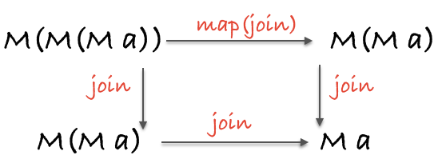
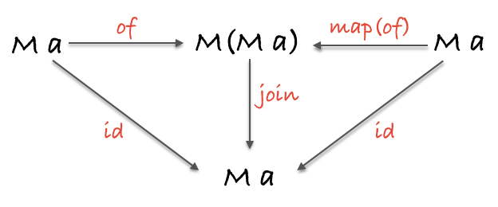

# 第 09 章：单子洋葱

## 尖头函子工厂

在咱们继续往下走之前，我得先坦白一件事：关于我们给每种类型都安上的那个 `of` 方法，我一直没跟你们完全说实话。闹了半天，它搁在那儿压根儿不是为了躲开 `new` 关键字，而是为了把值放进一个所谓的*默认最小上下文*里。没错，`of` 其实并不能顶替构造函数——它是一个重要接口的一部分，这个接口我们叫作*Pointed*。

> *指向函子*（pointed functor）就是带 `of` 方法的函子（functor）

这里头要紧的是这么一种本事：随手把任何值丢进我们的类型里，然后就开始一路 `map` 下去。

```js
IO.of('tetris').map(concat(' master'));
// IO('tetris master')

Maybe.of(1336).map(add(1));
// Maybe(1337)

Task.of([{ id: 2 }, { id: 3 }]).map(map(prop('id')));
// Task([2,3])

Either.of('The past, present and future walk into a bar...').map(concat('it was tense.'));
// Right('The past, present and future walk into a bar...it was tense.')
```

要是你还有印象，`IO` 和 `Task` 的构造函数都指望你传个函数进去，而 `Maybe` 和 `Either` 不。这个接口的动机，就是提供一种共同而一致的方式，把值放进我们的函子里，省得应付构造函数那些麻烦和特殊要求。“默认最小上下文”这个说法虽说不够精确，意思倒抓得挺准：我们想把任何值提升到自己的类型里，然后照常一路 `map`，该怎么表现就怎么表现——哪个函子有哪个函子的规矩。

这里我必须做出一处重要更正（这个双关是故意的）：`Left.of` 压根儿说不通。每个函子只能有一种把值放进去的方式，而对 `Either` 来说，那就是 `new Right(x)`。我们用 `Right` 来定义 `of`，因为我们的类型只要能 `map`，就*应该* `map`。瞧瞧上面那些例子，我们对 `of` 通常怎么工作应该有点直觉了，而 `Left` 正好把这个模子给砸了。

你也许听过 `pure`、`point`、`unit` 和 `return` 这几个函数。它们都是我们这个 `of` 方法的花名，一位身份成谜的国际神秘函数。等我们开始用单子（monad），`of` 就要紧起来了，因为，咱们很快就会看到，把值亲手塞回类型里是我们自己的责任。

为了躲开 `new` 关键字，JavaScript 里有好几样现成的花招和库，那咱们就用起来，从今往后像个负责任的成年人那样使唤 `of`。我推荐用 `folktale`、`ramda` 或者 `fantasy-land` 里的函子实例，它们都提供了正确的 `of` 方法，还配着不用 `new` 的漂亮构造函数。


## 比喻大乱炖


你看，除了太空卷饼（如果你听过那些传言），单子还像洋葱。让我用一个常见的场景演示一下：

```js
const fs = require('fs');

// readFile :: String -> IO String
const readFile = filename => new IO(() => fs.readFileSync(filename, 'utf-8'));

// print :: String -> IO String
const print = x => new IO(() => {
  console.log(x);
  return x;
});

// cat :: String -> IO (IO String)
const cat = compose(map(print), readFile);

cat('.git/config');
// IO(IO('[core]\nrepositoryformatversion = 0\n'))
```

我们这里得到的，是一个被困在另一个 `IO` 里的 `IO`，因为 `print` 在我们 `map` 的过程中又引出了一个 `IO`。想接着拿那个字符串干活，我们就得 `map(map(f))`；想看到效应，我们就得 `unsafePerformIO().unsafePerformIO()`。

```js
// cat :: String -> IO (IO String)
const cat = compose(map(print), readFile);

// catFirstChar :: String -> IO (IO String)
const catFirstChar = compose(map(map(head)), cat);

catFirstChar('.git/config');
// IO(IO('['))
```

看到两个效应被打包得整整齐齐、在应用里随时待命，这当然不错，可干起活来有点像穿着两套防化服，最后得到的 API 别扭得让人浑身难受。再看另一个场景：

```js
// safeProp :: Key -> {Key: a} -> Maybe a
const safeProp = curry((x, obj) => Maybe.of(obj[x]));

// safeHead :: [a] -> Maybe a
const safeHead = safeProp(0);

// firstAddressStreet :: User -> Maybe (Maybe (Maybe Street))
const firstAddressStreet = compose(
  map(map(safeProp('street'))),
  map(safeHead),
  safeProp('addresses'),
);

firstAddressStreet({
  addresses: [{ street: { name: 'Mulburry', number: 8402 }, postcode: 'WC2N' }],
});
// Maybe(Maybe(Maybe({name: 'Mulburry', number: 8402})))
```

又来了，还是函子套函子的局面：能看出函数里有三种可能的失败，这挺漂亮，可指望调用者 `map` 三次才够得着那个值，就有点太自作多情了——咱俩才刚认识呢。这种套路会一遍又一遍地冒出来，也正是我们需要把强大的单子标志打到夜空里的时候。

我说单子像洋葱，是因为我们每用 `map` 剥开嵌套函子的一层、想够到里面那个值，眼泪就往上涌。我们可以擦干眼睛，深吸一口气，用一个叫 `join` 的方法。

```js
const mmo = Maybe.of(Maybe.of('nunchucks'));
// Maybe(Maybe('nunchucks'))

mmo.join();
// Maybe('nunchucks')

const ioio = IO.of(IO.of('pizza'));
// IO(IO('pizza'))

ioio.join();
// IO('pizza')

const ttt = Task.of(Task.of(Task.of('sewers')));
// Task(Task(Task('sewers')));

ttt.join();
// Task(Task('sewers'))
```

要是我们有两层同一个类型，就能用 `join` 把它们砸扁成一层。这种合体的本事，这场函子间的婚姻，正是单子之所以为单子的原因。咱们往完整定义那边挪一小步，先来个稍微准确点的说法：

> 单子就是能压扁的指向函子

任何函子，只要定义了 `join` 方法、有 `of` 方法，并且遵守几条定律，那就是单子。定义 `join` 并不太难，那就拿 `Maybe` 开刀：

```js
Maybe.prototype.join = function join() {
  return this.isNothing() ? Maybe.of(null) : this.$value;
};
```

好了，简单得就像在娘胎里把自个儿的双胞胎兄弟给吸收了。如果我们手上是 `Maybe(Maybe(x))`，那 `.$value` 就会顺手剥掉那层多余的外壳，我们就可以放心地从那儿接着 `map`。否则，我们手上只会有一个 `Maybe`，因为压根儿就没有东西被 `map` 过。

现在有了 `join` 方法，咱们往 `firstAddressStreet` 这个例子上撒点神奇的单子粉末，看它显灵：

```js
// join :: Monad m => m (m a) -> m a
const join = mma => mma.join();

// firstAddressStreet :: User -> Maybe Street
const firstAddressStreet = compose(
  join,
  map(safeProp('street')),
  join,
  map(safeHead), safeProp('addresses'),
);

firstAddressStreet({
  addresses: [{ street: { name: 'Mulburry', number: 8402 }, postcode: 'WC2N' }],
});
// Maybe({name: 'Mulburry', number: 8402})
```

哪儿冒出嵌套的 `Maybe`，我们就在哪儿添个 `join`，免得它们一发不可收拾。对 `IO` 我们也照做一遍，找找手感。

```js
IO.prototype.join = function() {
  const $ = this;
  return new IO(() => $.unsafePerformIO().unsafePerformIO());
};
```

我们只是把跑两层 IO 这件事打包起来，依次执行：先外后内。请注意，我们并没有把纯粹性扔掉，只是把那两层多得离谱的保鲜膜重新包成了一包，好拆一点。

```js
// log :: a -> IO a
const log = x => new IO(() => {
  console.log(x);
  return x;
});

// setStyle :: Selector -> CSSProps -> IO DOM
const setStyle =
  curry((sel, props) => new IO(() => jQuery(sel).css(props)));

// getItem :: String -> IO String
const getItem = key => new IO(() => localStorage.getItem(key));

// applyPreferences :: String -> IO DOM
const applyPreferences = compose(
  join,
  map(setStyle('#main')),
  join,
  map(log),
  map(JSON.parse),
  getItem,
);

applyPreferences('preferences').unsafePerformIO();
// Object {backgroundColor: "green"}
// <div style="background-color: 'green'"/>
```

`getItem` 返回的是 `IO String`，所以我们 `map` 一下把它解析出来。`log` 和 `setStyle` 自己都返回 `IO`，所以我们得 `join`，把嵌套摁住。

## 我的链子拍在胸口


你可能已经看出套路了。我们常常在一个 `map` 之后紧接着就调 `join`。把这个抽象成一个函数吧，名字叫 `chain`。

```js
// chain :: Monad m => (a -> m b) -> m a -> m b
const chain = curry((f, m) => m.map(f).join());

// 或者

// chain :: Monad m => (a -> m b) -> m a -> m b
const chain = f => compose(join, map(f));
```

我们就是把 map/join 这套连招捆成一个函数。如果你以前读过讲单子的东西，可能见过 `chain` 被叫作 `>>=`（读作 bind）或者 `flatMap`，它们都是同一个概念的花名。我个人觉得 `flatMap` 这名字最贴切，但咱们还是用 `chain`，因为它在 JS 圈里接受度最广。用 `chain` 把上面两个例子重构一下：

```js
// map/join
const firstAddressStreet = compose(
  join,
  map(safeProp('street')),
  join,
  map(safeHead),
  safeProp('addresses'),
);

// chain
const firstAddressStreet = compose(
  chain(safeProp('street')),
  chain(safeHead),
  safeProp('addresses'),
);

// map/join
const applyPreferences = compose(
  join,
  map(setStyle('#main')),
  join,
  map(log),
  map(JSON.parse),
  getItem,
);

// chain
const applyPreferences = compose(
  chain(setStyle('#main')),
  chain(log),
  map(JSON.parse),
  getItem,
);
```

我把所有的 `map/join` 都换成了新的 `chain` 函数，收拾得利落一点。干净当然是好事，可 `chain` 的本事不止表面上这些——它更像龙卷风，而不是吸尘器。因为 `chain` 能毫不费力地把效应嵌套起来，我们就能用纯函数（pure function）式的方式，把*顺序执行*和*变量赋值*这两件事一并拿下。

```js
// getJSON :: Url -> Params -> Task JSON
getJSON('/authenticate', { username: 'stale', password: 'crackers' })
  .chain(user => getJSON('/friends', { user_id: user.id }));
// Task([{name: 'Seimith', id: 14}, {name: 'Ric', id: 39}]);

// querySelector :: Selector -> IO DOM
querySelector('input.username')
  .chain(({ value: uname }) =>
    querySelector('input.email')
      .chain(({ value: email }) => IO.of(`Welcome ${uname} prepare for spam at ${email}`))
  );
// IO('Welcome Olivia prepare for spam at olivia@tremorcontrol.net');

Maybe.of(3)
  .chain(three => Maybe.of(2).map(add(three)));
// Maybe(5);

Maybe.of(null)
  .chain(safeProp('address'))
  .chain(safeProp('street'));
// Maybe(null);
```

这些例子当然也能用 `compose` 写，但那样我们还得备几个辅助函数，况且这种风格本来就适合靠闭包做显式的变量赋值。所以我们改用 `chain` 的中缀版本——顺带一提，对任何类型来说，它都能从 `map` 和 `join` 自动推导出来：`t.prototype.chain = function(f) { return this.map(f).join(); }`。要是我们想要一种虚假的性能优越感，也可以手写 `chain`，不过得小心保住正确的功能——也就是说，它必须等于先 `map` 再 `join`。有个挺有意思的事实：一旦造出了 `chain`，我们就能白捡一个 `map`，办法就是在收尾时用 `of` 把值重新装回瓶子里。有了 `chain`，我们还能把 `join` 定义成 `chain(id)`。这感觉就像跟一位镶水钻的魔术师打德州扑克，我这些玩意儿全是凭空从屁股后头拽出来的；不过，跟大多数数学一样，这些有原则的构造本来就是互相勾连的。很多这类推导都写在 [fantasyland](https://github.com/fantasyland/fantasy-land) 仓库里，那是 JavaScript 里代数数据类型（algebraic data type）的官方规范。

总之，回到上面那些例子。第一个例子里，我们看见两个 `Task` 被串成一串异步动作——先取回 `user`，再用这个用户的 id 去找他的朋友。我们用 `chain` 来避免出现 `Task(Task([Friend]))` 这种局面。

接下来，我们用 `querySelector` 找到几个不同的输入框，拼出一句欢迎语。注意，在最里层那个函数里，`uname` 和 `email` 我们俩都够得着——这就是函数式变量赋值的巅峰之作。既然 `IO` 大方地把值借给了我们，那把它原样放回去就是我们的责任——我们可不想辜负它的信任（连带把程序搞砸）。`IO.of` 干这活儿最合适，这也是为什么 Pointed 是 Monad 接口的重要前提。不过，我们也可以选择 `map`，因为它同样会返回正确的类型：

```js
querySelector('input.username').chain(({ value: uname }) =>
  querySelector('input.email').map(({ value: email }) =>
    `Welcome ${uname} prepare for spam at ${email}`));
// IO('Welcome Olivia prepare for spam at olivia@tremorcontrol.net');
```

最后是两个用 `Maybe` 的例子。因为 `chain` 骨子里还是在 `map`，所以只要有哪个值是 `null`，计算就当场原地熄火。

这些例子一开始不太好懂，别担心。玩它们。拿根棍子戳它们。砸个稀巴烂再重新拼起来。记住：返回“普通”值的时候用 `map`，返回另一个函子的时候用 `chain`。下一章我们会去会会应用函子（applicative functor），看看有哪些漂亮花招能让这类表达式更好看、更好读。

提醒一句：碰上两种不同的嵌套类型，这招就不灵了。函子组合，以及后面会讲到的单子变换器（monad transformer），能在那种情况下帮上忙。

## 耍威风的瘾

容器风格的编程有时候挺让人晕。我们时不时会为搞不清一个值到底套了几层容器、或者该用 `map` 还是 `chain` 而苦苦挣扎（很快我们还会见到更多容器方法）。实现一个 `inspect` 之类的花招能大大改善调试，我们也会学着造一个“栈”，管你扔什么效应过来它都接得住；可有些时候，我们还是忍不住怀疑这一通折腾到底值不值。

我想抡一会儿那把燃烧的单子之剑，展示一下这么编程有多猛。

咱们读一个文件，然后紧接着把它传上去：

```js
// readFile :: Filename -> Either String (Task Error String)
// httpPost :: String -> String -> Task Error JSON
// upload :: Filename -> Either String (Task Error JSON)
const upload = compose(map(chain(httpPost('/uploads'))), readFile);
```

这里我们的代码分了好几个岔。光看类型签名（type signature）就能看出，我们防住了 3 种错误——`readFile` 用 `Either` 来校验输入（也许是确保文件名确实在），`readFile` 在访问文件时可能出错，这一点由 `Task` 的第一个类型参数表达，而上传可能因为随便什么原因失败，这一点由 `httpPost` 里的 `Error` 表达。我们漫不经心地就用 `chain` 搞定了两个嵌套的、顺序执行的异步动作。

这一切都靠在一条从左到右的线性流程里完成。全是纯的，全是声明式的。它保得住等式推理（equational reasoning），也保得住可靠的性质。我们没被逼着加一堆没用又让人糊涂的变量名。我们的 `upload` 函数是照着通用接口写的，不是冲着某个一次性 api 写的。我的天，它就只有天杀的一行。

为了对比，看看命令式的标准做法是怎么搞定这事的：

```js
// upload :: Filename -> (String -> a) -> Void
const upload = (filename, callback) => {
  if (!filename) {
    throw new Error('You need a filename!');
  } else {
    readFile(filename, (errF, contents) => {
      if (errF) throw errF;
      httpPost('/uploads', contents, (errH, json) => {
        if (errH) throw errH;
        callback(json);
      });
    });
  }
};
```

哎哟，这不就是魔鬼算术嘛。我们像弹珠一样被弹来弹去，穿过一座变化无常的疯狂迷宫。想象一下，要是这是个典型的应用，沿途还要顺手改改变量！那我们可真就陷进焦油坑里了。

## 理论

我们要看的第一条定律是结合律，不过可能不是你习惯的那种样子。

```js
// 结合律
compose(join, map(join)) === compose(join, join);
```

这些定律针对的是单子那种嵌套的天性，所以结合律关注的是：先合并里面那层还是先合并外面那层，结果都一样。画个图可能更好懂：



从左上角往下走，我们可以先把 `M(M(M a))` 外面那两个 `M` 给 `join` 掉，再一路溜到我们想要的 `M a`。换个走法，我们也可以掀开引擎盖，用 `map(join)` 把里面那两个 `M` 压平。不管你先前合并的是里面那层还是外面那层，最后得到的都是同一个 `M a`，结合律说的就是这个。值得一提的还有 `map(join) != join`。中间步骤的值可以不一样，但最后一次 `join` 的最终结果一定相同。

第二条定律差不多：

```js
// 对所有 (M a) 的恒等律
compose(join, of) === compose(join, map(of)) === id;
```

它说的是，对任何单子 `M` 而言，`of` 再 `join` 就等于 `id`。我们也可以 `map(of)`，从里往外攻。我们管这叫“三角恒等律”，因为画出来正好是那么个形状：



从左上角往右走，我们看到 `of` 确实把我们的 `M a` 丢进了另一个 `M` 容器。接着往下走再 `join` 一下，结果跟我们一开始直接调 `id` 一模一样。反过来从右往左走，我们会发现，就算我们从被窝底下偷偷用 `map` 对那个普通的 `a` 调用 `of`，最后照样得到 `M (M a)`，再 `join` 一下就回到原点。

我得提一句，我上面只写了 `of`，但它必须是我们所用那个单子自己的 `M.of`。

话说，这两条定律——恒等律和结合律——我好像在哪儿见过……等等，我想想……对对对！它们是范畴的定律。可那样的话，我们还需要一个组合函数才能把定义凑齐。瞧好了：

```js
const mcompose = (f, g) => compose(chain(f), g);

// 左恒等律
mcompose(M, f) === f;

// 右恒等律
mcompose(f, M) === f;

// 结合律
mcompose(mcompose(f, g), h) === mcompose(f, mcompose(g, h));
```

说到底，它们就是范畴定律。单子构成一个叫作“Kleisli 范畴”的范畴，其中所有对象都是单子，态射（morphism）则是被串起来的函数。我可不是故意拿范畴论（category theory）的零碎来逗你，又不讲清楚这些拼图怎么拼。我的本意只是浅浅刮一层皮，让你看出其中的相关性、勾起一点兴趣，同时把重点放在我们每天都能用得上的实用性质上。


## 总结

单子让我们能一路往下钻进嵌套的计算里。我们可以给变量赋值、按顺序跑效应、执行异步任务，而一块砖都不用往“末日金字塔”上垒。当一个值发现自己被关在同一类型的层层牢房里，单子就来救命了。在可靠的小跟班“pointed”的帮助下，单子能把没装箱的值借给我们，并且知道我们干完活肯定能把它放回去。

没错，单子很强，可我们还是会发现自己需要一些额外的容器函数。比如说，我们想一次跑一串 api 调用，再把结果收拢起来，怎么办？用单子也能办成，但我们必须等一个跑完才能调下一个。那要是把好几个校验组合起来呢？我们想继续校验下去，把所有错误攒成一张清单，可只要第一个 `Left` 一登场，单子就让整场演出停摆了。

下一章我们会看到应用函子怎么融进容器的世界，以及为什么在很多情况下我们更偏爱它们而不是单子。

[第 10 章：应用函子](ch10.md)


## 练习


考虑下面这么一个 User 对象：

```js
const user = {
  id: 1,
  name: 'Albert',
  address: {
    street: {
      number: 22,
      name: 'Walnut St',
    },
  },
};
```


给定一个 user，用 `safeProp` 和 `map/join` 或 `chain` 安全地取出街道名


```js
// getStreetName :: User -> Maybe String
const getStreetName = undefined;
```








---


现在我们考虑下面这几样东西：

```js
// getFile :: IO String
const getFile = IO.of('/home/mostly-adequate/ch09.md');

// pureLog :: String -> IO ()
const pureLog = str => new IO(() => console.log(str));
```


用 getFile 拿到文件路径，去掉目录，只保留文件名，
然后纯粹地把它打印出来。提示：你可能想用 `split` 和 `last`
从文件路径里取出文件名。


```js
// logFilename :: IO ()
const logFilename = undefined;

```








---

这道练习里，我们考虑几个具有如下签名的辅助函数：

```js
// validateEmail :: Email -> Either String Email
// addToMailingList :: Email -> IO([Email])
// emailBlast :: [Email] -> IO ()
```


用 `validateEmail`、`addToMailingList` 和 `emailBlast` 写一个函数：
如果邮箱有效，就把新邮箱加进邮件列表，
然后通知整个列表。


```js
// joinMailingList :: Email -> Either String (IO ())
const joinMailingList = undefined;
```






