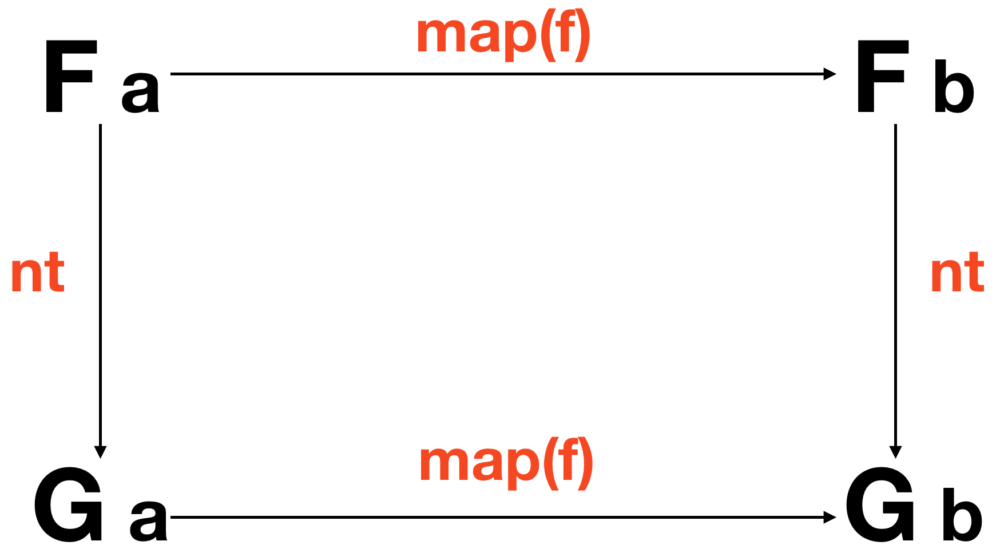

# 第 11 章：自然而然地再变换

我们即将在“日常代码里的实际用处”这个语境下讨论*自然变换*（natural transformation）。碰巧，它也是范畴论（category theory）的一根支柱，在把数学用于推理和重构代码时绝对不可或缺。正因如此，我觉得有责任提前通知你：接下来你将要目睹的那桩令人遗憾的不公，毫无疑问是我视野有限造成的。咱们开始吧。

## 这要命的嵌套

我想说说嵌套这档子事。不是准爸妈那种本能的冲动——那种非得强迫症似地收拾、归置、挪来挪去的劲头——而是……嗯，其实仔细一想，这跟我说的也差不离，后面的章节里咱们就会看到……总之，我说的*嵌套*，是指两种或更多不同的类型全挤在一个值周围，像抱新生儿那样把它搂在中间。

```js
Right(Maybe('b'));

IO(Task(IO(1000)));

[Identity('bee thousand')];
```

到目前为止，靠着精心打磨的例子，我们一直躲着这个常见场景，但在实践中，人一写代码，类型就会自己缠成一团，活像在驱魔现场被甩来甩去的耳机线。要是一路写下去不仔仔细细把类型收拾整齐，我们的代码读起来会比坐在猫咪咖啡馆里的垮掉派还毛茸茸。

## 情景喜剧

```js
// getValue :: Selector -> Task Error (Maybe String)
// postComment :: String -> Task Error Comment
// validate :: String -> Either ValidationError String

// saveComment :: () -> Task Error (Maybe (Either ValidationError (Task Error Comment)))
const saveComment = compose(
  map(map(map(postComment))),
  map(map(validate)),
  getValue('#comment'),
);
```

大伙儿全到齐了，可把咱们的类型签名（type signature）愁坏了。容我简单解释一下这段代码。我们先用 `getValue('#comment')` 取得用户输入，这是个动作，用来取某个元素上的文本。它可能在找元素时出错，也可能那个值字符串压根儿不存在，所以它返回 `Task Error (Maybe String)`。接着，我们必须在 `Task` 和 `Maybe` 两层上都 `map`，把文本传给 `validate`，它则还给我们一个 `Either`：要么是 `ValidationError`，要么是我们的 `String`。然后就一路映射到底，把当前 `Task Error (Maybe (Either ValidationError String))` 里的那个 `String` 送进 `postComment`，它返回我们最终的那个 `Task`。

多么可怕的一团乱麻。一幅抽象类型的拼贴画，业余的类型表现主义，多态的波洛克，一整块的蒙德里安。这个常见问题有很多种解法。我们可以把这些类型组合成一个巨兽般的容器，把其中几个排好序再 `join` 掉，把它们同质化，把它们解构，诸如此类。本章我们要专注于用*自然变换*把它们同质化。

## 纯天然

*自然变换*是一种“函子（functor）之间的态射（morphism）”，也就是说，一个作用在容器本身上的函数。从类型上看，它是一个 `(Functor f, Functor g) => f a -> g a` 的函数。它的特别之处在于：不管出于什么理由，我们都绝不能偷看函子里的内容。把它想成一次高度机密的情报交换——双方都不知道那只盖着“绝密”印章的密封牛皮纸袋里装的是什么。这是一种结构性的操作。一次函子层面的换装。形式上，*自然变换*就是满足下面这条等式的任意函数：



或者用代码写：

```js
// nt :: (Functor f, Functor g) => f a -> g a
compose(map(f), nt) === compose(nt, map(f));
```

图和代码说的是同一件事：我们可以先跑自然变换再 `map`，也可以先 `map` 再跑自然变换，得到的结果一样。顺带一提，这是从一条[自由定理](ch07.md#白送的定理)推出来的，尽管自然变换（以及函子）并不局限于类型上的函数。

## 有原则的类型转换

作为程序员，我们对类型转换并不陌生。我们把 `Strings` 这样的类型变成 `Booleans`，把 `Integers` 变成 `Floats`（尽管 JavaScript 只有 `Numbers`）。这里的区别只在于：我们摆弄的是代数容器，而且手头有些理论可以差遣。

看几个例子：

```js
// idToMaybe :: Identity a -> Maybe a
const idToMaybe = x => Maybe.of(x.$value);

// idToIO :: Identity a -> IO a
const idToIO = x => IO.of(x.$value);

// eitherToTask :: Either a b -> Task a b
const eitherToTask = either(Task.rejected, Task.of);

// ioToTask :: IO a -> Task () a
const ioToTask = x => new Task((reject, resolve) => resolve(x.unsafePerform()));

// maybeToTask :: Maybe a -> Task () a
const maybeToTask = x => (x.isNothing ? Task.rejected() : Task.of(x.$value));

// arrayToMaybe :: [a] -> Maybe a
const arrayToMaybe = x => Maybe.of(x[0]);
```

明白这个思路了吧？我们只是把一个函子换成另一个函子。途中允许丢掉一些信息，只要我们将要 `map` 的那个值没在变形走位的过程中被弄丢就行。这才是全部要点：按我们的定义，即使完成转换之后，`map` 也必须照常进行。

一种看法是：我们转换的是自己的效应。这么一看，`ioToTask` 就是把同步转成异步，`arrayToMaybe` 就是从不确定性（nondeterminism）转成可能的失败。注意，在 JavaScript 里我们没法把异步转成同步，所以写不出 `taskToIO`——那得叫超自然变换。

## 特性嫉妒

假设我们想用另一个类型的某些特性，比如想在 `List` 上用 `sortBy`。*自然变换*提供了一条漂亮的路子，能转换到目标类型，同时知道我们的 `map` 依然可靠。

```js
// arrayToList :: [a] -> List a
const arrayToList = List.of;

const doListyThings = compose(sortBy(h), filter(g), arrayToList, map(f));
const doListyThings_ = compose(sortBy(h), filter(g), map(f), arrayToList); // 应用定律
```

鼻子一皱，魔杖敲三下，把 `arrayToList` 丢进去，瞧！我们的 `[a]` 就成了 `List a`，想 `sortBy` 就尽管排。

另外，像 `doListyThings_` 里那样把 `map(f)` 挪到*自然变换*左边，优化／融合操作也会变得更容易。

## 同构的 JavaScript

当我们能完全来回转换、一点信息都不丢时，这就叫*同构*（isomorphism）。这不过是个花哨的说法，意思就是“装着同样的数据”。如果我们能拿出“去”和“回”两个方向的*自然变换*当证明，我们就说这两个类型是*同构的*：

```js
// promiseToTask :: Promise a b -> Task a b
const promiseToTask = x => new Task((reject, resolve) => x.then(resolve).catch(reject));

// taskToPromise :: Task a b -> Promise a b
const taskToPromise = x => new Promise((resolve, reject) => x.fork(reject, resolve));

const x = Promise.resolve('ring');
taskToPromise(promiseToTask(x)) === x;

const y = Task.of('rabbit');
promiseToTask(taskToPromise(y)) === y;
```

证毕。`Promise` 和 `Task` 是*同构的*。我们也可以写一个 `listToArray` 来跟 `arrayToList` 配对，证明它们俩也一样。再看个反例：`arrayToMaybe` 不是*同构*，因为它会丢信息：

```js
// maybeToArray :: Maybe a -> [a]
const maybeToArray = x => (x.isNothing ? [] : [x.$value]);

// arrayToMaybe :: [a] -> Maybe a
const arrayToMaybe = x => Maybe.of(x[0]);

const x = ['elvis costello', 'the attractions'];

// 不同构
maybeToArray(arrayToMaybe(x)); // ['elvis costello']

// 但是个自然变换
compose(arrayToMaybe, map(replace('elvis', 'lou')))(x); // Just('lou costello')
// ==
compose(map(replace('elvis', 'lou')), arrayToMaybe)(x); // Just('lou costello')
```

不过它们确实是*自然变换*，因为两边 `map` 出来的结果一样。我趁这话题正热、半路插一句*同构*，可别被它骗了——这是个威力巨大、无处不在的概念。总之，咱们接着往下走。

## 一个更宽泛的定义

这些结构性函数绝不仅限于类型转换。

这儿有几个不一样的：

```hs
reverse :: [a] -> [a]

join :: (Monad m) => m (m a) -> m a

head :: [a] -> a

of :: a -> f a
```

自然变换的定律对这些函数同样成立。有一点可能会把你绊住：`head :: [a] -> a` 可以看成 `head :: [a] -> Identity a`。在证明定律的时候，我们想往哪儿插 `Identity` 就往哪儿插，因为反过来我们也能证明 `a` 与 `Identity a` 同构（看吧，我说过*同构*无处不在）。

## 一种嵌套的解法

回到我们那个喜剧式的类型签名。我们可以在调用代码的各处撒上一些*自然变换*，把各个不一样的类型强行掰得统一，这样它们就能被 `join` 了。

```js
// getValue :: Selector -> Task Error (Maybe String)
// postComment :: String -> Task Error Comment
// validate :: String -> Either ValidationError String

// saveComment :: () -> Task Error Comment
const saveComment = compose(
  chain(postComment),
  chain(eitherToTask),
  map(validate),
  chain(maybeToTask),
  getValue('#comment'),
);
```

那么现在咱们手上是什么？我们只是加了 `chain(maybeToTask)` 和 `chain(eitherToTask)`。两者效果一样：它们把我们 `Task` 抱着的那个函子自然地变换成另一个 `Task`，再把两者 `join` 起来。就像窗台上的防鸽刺，我们在源头就把嵌套挡住了。正如光之城那句俗话所说：“Mieux vaut prévenir que guérir”——一盎司的预防，抵得上一磅的治疗。

## 总结

*自然变换*是作用在我们函子本身上的函数。它在范畴论里是个极其重要的概念，一旦采用更多抽象，它就会开始到处出现；不过眼下，我们只把它圈在几个具体的应用上。如我们所见，只要保证组合依然成立，就能靠转换类型达到不同的效应。它们也能帮我们处理嵌套类型，尽管它们的一般效果是把函子同质化到最小公分母——在实践中，就是那个效应最飘忽不定的函子（大多数情况下是 `Task`）。

这种没完没了又乏味的类型整理，就是我们让类型现形——把它们从以太里召唤出来——所付的代价。当然，隐式效应要阴险得多，所以我们才在这儿打这场正义之战。要想钓上更大块的类型大杂烩，我们的工具箱里还得再添几样家伙。接下来，我们要看看用 *Traversable* 给类型重新排序。

[第 12 章：穿越石头](ch12.md)


## 练习

  
写一个自然变换，把 `Either b a` 转换成 `Maybe a`
  
  
```js  
// eitherToMaybe :: Either b a -> Maybe a  
const eitherToMaybe = undefined;  
```  
  
  
  
  
  
  
  
  
---  


```js
// eitherToTask :: Either a b -> Task a b
const eitherToTask = either(Task.rejected, Task.of);
```

  
用 `eitherToTask` 简化 `findNameById`，去掉那层嵌套的 `Either`。
  
  
```js  
// findNameById :: Number -> Task Error (Either Error User)  
const findNameById = compose(map(map(prop('name'))), findUserById);  
```  
  
  
  
  
  
  
  
  
---  


提醒一下，练习的上下文里可以用下面这些函数：

```hs
split :: String -> String -> [String]
intercalate :: String -> [String] -> String
```

  
写出 String 和 [Char] 之间的同构。
  
  
```js  
// strToList :: String -> [Char]  
const strToList = undefined;  
  
// listToStr :: [Char] -> String  
const listToStr = undefined;  
```  
  
  
  
  
  
  
